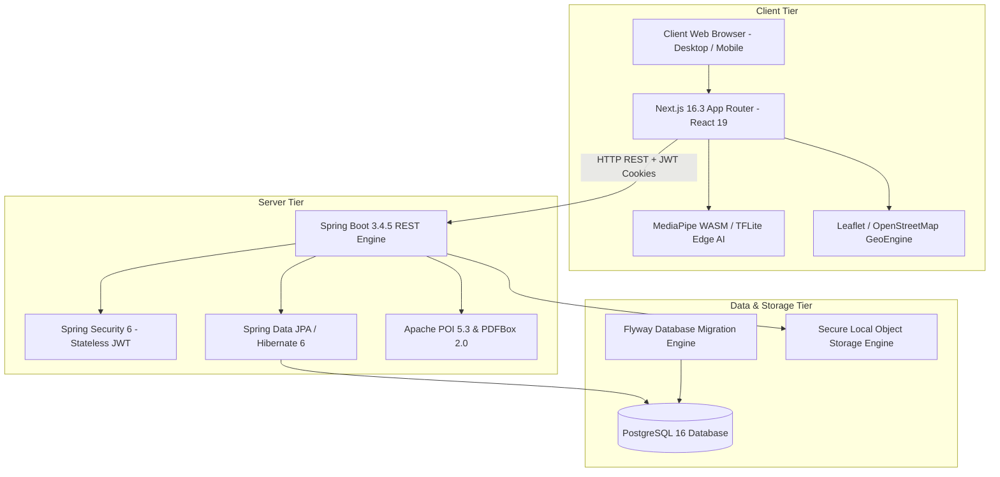
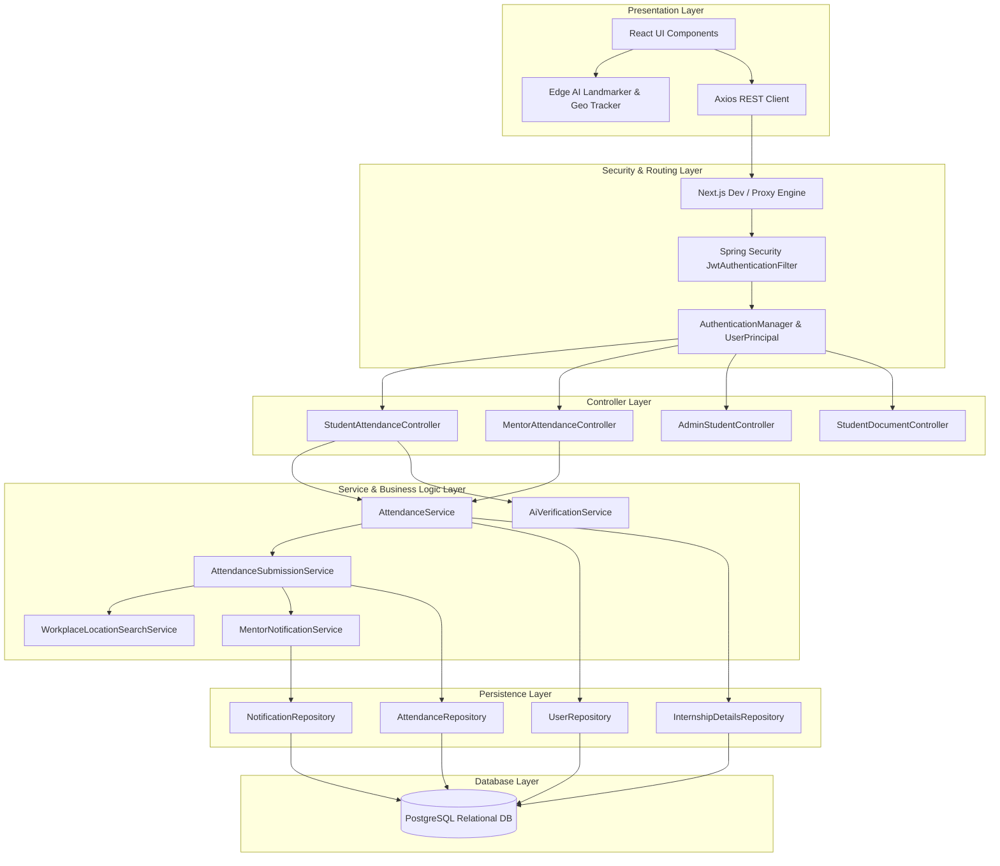
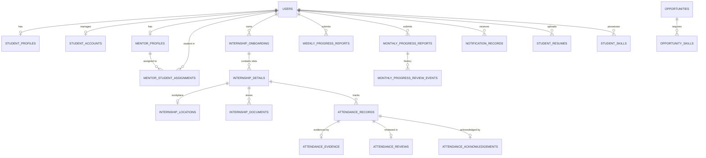
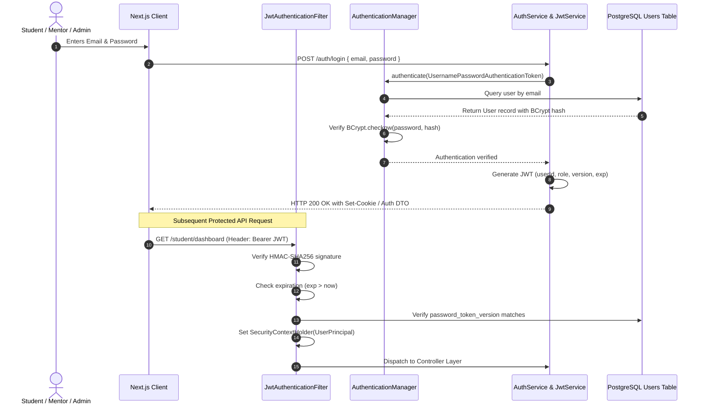
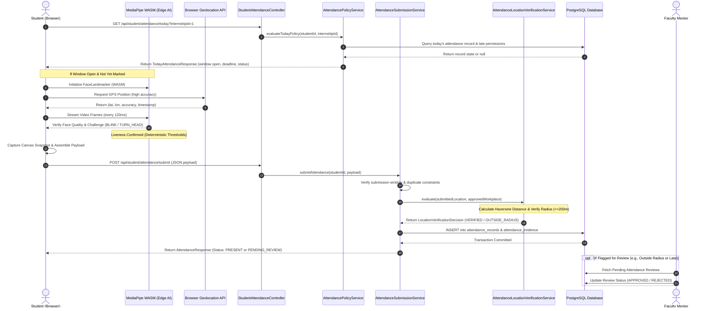
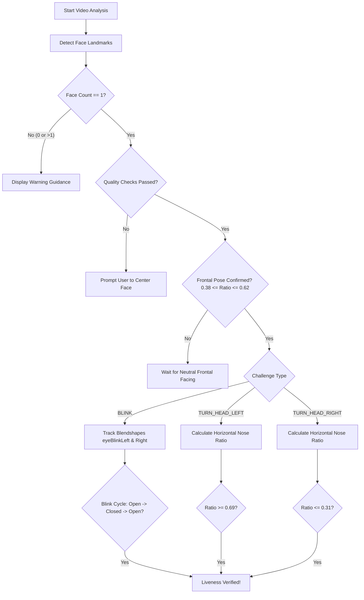
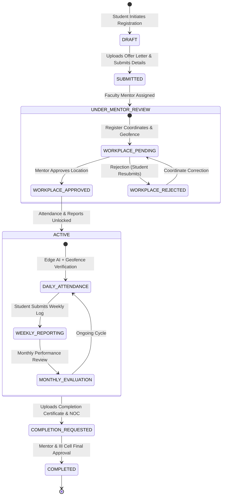
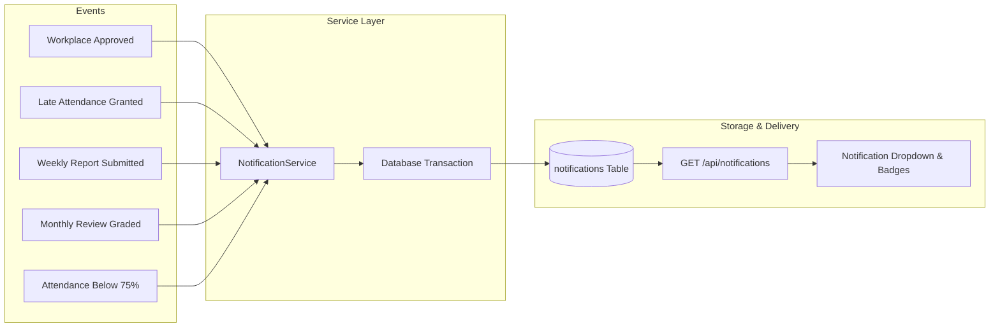
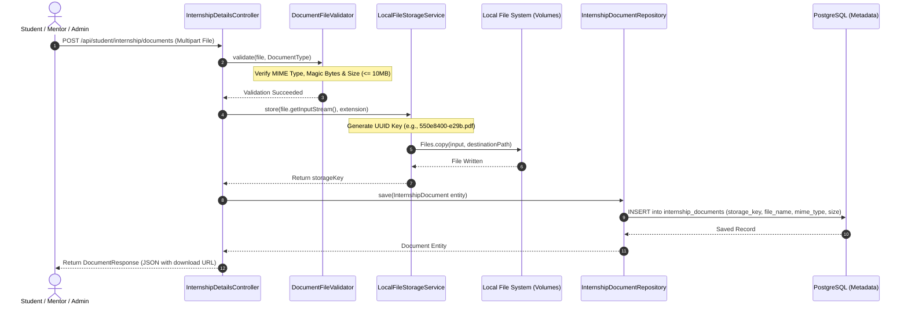
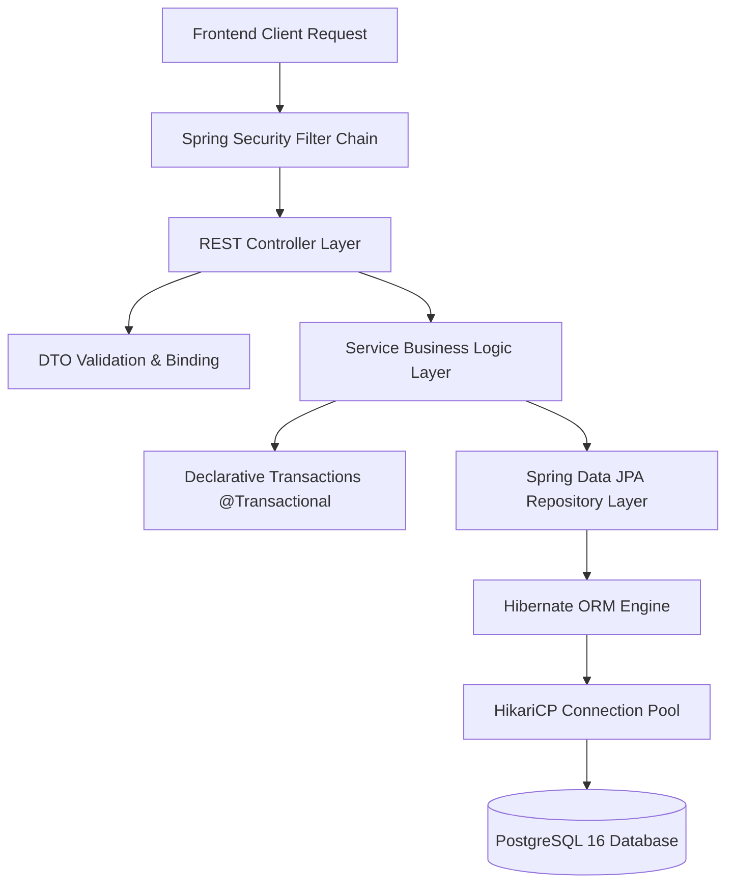

# COMPLETE TECHNICAL ARCHITECTURE, FUNCTIONAL WORKFLOWS, ALGORITHMS, AND IMPLEMENTATION OF THE INTERNSHIP MANAGEMENT SYSTEM (IMS)

---

# CHAPTER 1: PROJECT INTRODUCTION

### 1.1 What is an Internship Management System?
An **Internship Management System (IMS)** is an enterprise academic and institutional web application designed to govern, track, verify, and evaluate students' experiential learning in industry internships. In contemporary engineering, polytechnic, and university curricula, mandatory off-campus industrial internships represent a vital bridge connecting academic theoretical coursework with real-world professional practice.

However, once students disperse into geographically distributed corporations, startup incubators, manufacturing facilities, or remote work environments, educational institutions face severe governance hurdles:
- How does the college verify that a student is physically reporting to their assigned workplace every morning rather than submitting attendance from their dorm room or home?
- How do faculty mentors monitor ongoing technical activities without relying on retrospective, potentially fabricated end-of-semester paper reports?
- How does the Industry-Institute Interaction (III) Cell ensure compliance with regional accreditation bodies (e.g., NBA, NAAC, AICTE) without spending weeks reconciling spreadsheets, physical signatures, and scanned certificates?

The **Internship Management System (IMS)** solves these systemic challenges by digitizing the entire internship lifecycle. It integrates:
1. **Edge AI Computer Vision Liveness Verification**: Verifies live, physical presence via on-device face landmarker analysis and randomized real-time facial challenges (natural blink, left turn, right turn).
2. **Geofenced Workplace Verification**: Mathematical Haversine coordinate validation requiring student device GPS readings to fall within a strictly enforced 200-meter radius of the mentor-approved corporate workplace.
3. **Structured Weekly and Monthly Progress Governance**: Continuous, timestamped progress diaries with supervisor review, ratings, and mentor feedback loops.
4. **Institutional Dynamic Reporting & Compliance**: Real-time exportable institutional catalogs, monthly EXIF photo metadata validation, absence tracking, and dual-internship isolation.

---

### 1.2 The Problem with Traditional Manual Internship Administration
In traditional college environments, internship governance relies on fragmented manual paperwork, spreadsheets, and informal messaging:
1. **Attendance Fraud & Physical Absence**: Traditional attendance relies on signed paper sheets or periodic employer letters delivered at the end of the semester. Students frequently forge signatures or collude to claim attendance while being physically absent.
2. **Retrospective Reporting & Ghost Work**: Students often submit an entire semester's worth of "weekly reports" in a single weekend right before the viva examination. Mentors have no mechanism to establish whether work occurred progressively or was copied from previous batches.
3. **Delayed Problem Detection**: If a student is dropped from an internship or placed on unauthorized leave, the college typically discovers it months later when final evaluation fails.
4. **Administrative Bottlenecks in the III Cell**: Placement and training officers must manually verify hundreds of offer letters, track company approvals, compute cumulative attendance percentages, and identify students failing the mandatory 75% attendance threshold.
5. **Dual Internship Chaos**: Modern academic flexibility allows eligible high-performing students to undertake two internships (e.g., a morning research fellowship and an evening corporate practicum, or consecutive seasonal tracks). In manual systems, tracking two concurrent or consecutive internships for one student creates massive spreadsheet synchronization errors, overwriting attendance records or assigning conflicting mentors.

---

### 1.3 How IMS Solves These Problems
| Traditional Manual Process | The IMS Automated Solution |
|---|---|
| Paper attendance sheets signed at end of month | Daily server-enforced attendance window with GPS geofencing & biometric liveness |
| Trust-based location reporting | Sub-meter Haversine distance calculation against mentor-locked workplace coordinates |
| Retrospective end-of-semester reports | Strictly sequenced weekly and monthly progress reports with revision versioning |
| Scattered email attachments & WhatsApp PDFs | Centralized encrypted document vault with role-based preview and verification |
| Single spreadsheet per department | Multi-tenant PostgreSQL database with Flyway schema migration and full audit trails |
| Confused tracking of dual internships | First-class dual-internship slotting (Internship 1 & 2) with data isolation |

---

### 1.4 Intended User Personas
The IMS architecture serves three distinct institutional roles:
1. **Student (`ROLE_STUDENT`)**:
   - Registers personal, academic, and professional profiles (with AES-encrypted Aadhaar identity).
   - Manages Internship 1 and (optional) Internship 2 slots.
   - Submits company details, official offer letters, and corporate workplace coordinates.
   - Performs daily attendance using the mirrored front camera with on-device Edge AI facial challenge verification and GPS capture.
   - Submits weekly progress reports and monthly progress reports with work evidence photos.
   - Explores matching career opportunities and analyzes skill gaps.
2. **Faculty Mentor (`ROLE_MENTOR`)**:
   - Supervised by assigned department faculty members.
   - Inspects assigned students across their active internships.
   - Approves or requests corrections on company registration and workplace coordinates on interactive OpenStreetMap maps.
   - Reviews daily attendance submissions, flags geofence discrepancies, and grants late attendance permissions.
   - Grades and approves weekly diaries and monthly progress submissions.
   - Accesses the Mentor Reports Center for real-time compliance analytics.
3. **III Cell Incharge / Administrator (`ROLE_ADMIN`)**:
   - Central authority representing the Placement, Training, and Industry Interaction Cell.
   - Manages institutional academic sessions, departments, student accounts, and mentor allocations.
   - Evaluates second internship approval requests.
   - Publishes institutional career opportunities and triggers automated skill-match algorithms.
   - Executes dynamic custom reports with multi-criteria filtering across all institutional metrics.
   - Generates official PDF and Excel (POI) compliance exports for accreditation audits.

---

### 1.5 What Makes IMS Different from a Basic CRUD Application?
A standard CRUD (Create, Read, Update, Delete) application simply accepts user form inputs and writes them blindly to database tables. IMS differs fundamentally across multiple architectural tiers:
1. **Client-Side Edge AI Inference Without Cloud Latency**: Instead of streaming sensitive video frames to an expensive cloud server, IMS downloads an optimized TensorFlow Lite model (`face_landmarker.task`) to the student's browser via WebAssembly (WASM). Landmark evaluation occurs locally at 120ms intervals, ensuring zero privacy leakage of student biometrics while defeating static photo spoofing.
2. **Cryptographic Geolocation Triangulation**: Attendance is not a checkbox. It is a cryptographic bundle containing browser high-accuracy GPS coordinates, reported hardware accuracy in meters, server-side timestamp validation, and mathematical spherical geometry calculation against mentor-verified anchor coordinates.
3. **State Machine Lifecycle Enforcement**: An internship is governed by an immutable state machine (`PRE_COMMENCEMENT` -> `ONBOARDING` -> `INTERNSHIP_DETAILS_PENDING` -> `WORKPLACE_PENDING` -> `ACTIVE` -> `COMPLETED`). Transitions require cryptographic checks, single-use edit tokens, and mentor approvals.
4. **Strict Dual-Internship Data Isolation**: A student entity maintains completely isolated parallel states for Internship 1 and Internship 2. Neither attendance, notifications, workplace geofences, nor mentor reviews bleed into the sibling internship slot.

---

### 1.6 Three Explanations of IMS

#### Form A: For a Non-Technical Person
> "Think of IMS as a digital supervisor for college students doing company internships. Instead of signing paper sheets or emailing reports, students use a web app on their phone or laptop. Every morning, the app checks two things before marking attendance: first, it uses the camera to make sure the real student is physically there (asking them to blink or turn their head, so nobody can hold up a photo), and second, it checks their GPS location to ensure they are physically inside their company's office. Mentors can see daily progress, read weekly reports, and approve documents online. The college administration gets instant reports showing who is working hard, who is absent, and how the internship program is performing."

#### Form B: For a Computer Science Engineering Student
> "IMS is a full-stack, distributed web application built on Next.js 16 (React 19, TypeScript) and Spring Boot 3.4 (Java 17, Spring Security 6) backed by PostgreSQL 16. It implements on-device Edge AI using Google MediaPipe Tasks Vision WebAssembly to execute 478-point 3D facial mesh landmark detection and head-pose yaw estimation inside the client's browser, preventing server processing bottlenecks and biometric privacy violations. Geolocation validation uses the browser Geolocation API coupled with the spherical Haversine formula on the backend to enforce a strict 200-meter circular geofence around mentor-approved company coordinates. Security is maintained via stateless JWT tokens stored in HttpOnly cookies, BCrypt password hashing, and role-based access control (RBAC). The database architecture enforces referential integrity through 50 versioned Flyway migrations, supporting soft deletions, audit logging, and isolated multi-internship slotting."

#### Form C: For an External Examiner / Technical Auditor
> "The Internship Management System is an enterprise-grade institutional resource governance platform engineered around architectural tiers of zero-trust verification and local edge computation. Biometric participation verification is achieved via deterministic client-side tensor inference using Google MediaPipe Tasks Vision (`@mediapipe/tasks-vision`) compiled to WebAssembly with SIMD acceleration. The inference pipeline extracts canonical facial mesh indices (Nose tip: 1, Zygomatic arches: 234 and 454) to calculate real-time normalized nose-to-cheek horizontal ratios:
> $$\\text{Ratio} = \\frac{\\text{nose}_x - \\min(\\text{cheek}_A.x, \\text{cheek}_B.x)}{|\\text{cheek}_B.x - \\text{cheek}_A.x|}$$
> This enables robust head-pose yaw trajectory analysis against server-generated pseudo-random challenges (BLINK, TURN_HEAD_LEFT, TURN_HEAD_RIGHT) within finite 30-second sliding windows, mitigating replay, deepfake, and static image injection attacks.
> Geospatial authentication calculates great-circle arc distances over an oblate earth model using the backend Haversine algorithm, asserting:
> $$d = 2R \\arcsin \\left(\\sqrt{\\sin^2\\left(\\frac{\\Delta \\phi}{2}\\right) + \\cos(\\phi_1)\\cos(\\phi_2)\\sin^2\\left(\\frac{\\Delta \\lambda}{2}\\right)}\\right) \\le 200\\text{ m}$$
> Server architecture follows a layered DDD (Domain-Driven Design) paradigm in Spring Boot 3.4 utilizing JPA/Hibernate with pessimistic row-level locking (`PESSIMISTIC_WRITE`) on concurrent attendance updates. Database integrity is preserved across 50 Flyway migrations featuring AES-GCM encrypted PII storage, composite indexing on `(student_id, internship_id, attendance_date)`, and complete audit trails for administrative compliance."

---

# CHAPTER 2: COMPLETE TECHNOLOGY STACK



### 2.1 Full Technology Catalog
The following technologies represent the verified, implemented software stack derived directly from `frontend/package.json`, `backend/pom.xml`, and the active configuration files:

| Layer | Technology | Verified Version | Purpose in IMS | Source Reference |
|---|---|---|---|---|
| Frontend Framework | Next.js | 16.3.8 | React server/client application framework, App Router | `frontend/package.json` |
| UI Library | React | 19.3.0 | Component-based reactive view rendering | `frontend/package.json` |
| Programming Language | TypeScript | 5.8.3 | Static typing, interface definitions, safety | `frontend/package.json` |
| CSS Styling | Tailwind CSS | 4.1.5 | Utility-first CSS styling system | `frontend/package.json` |
| HTTP Client | Axios | 1.8.4 | REST communication with backend | `frontend/lib/api.ts` |
| Edge AI Runtime | MediaPipe Tasks Vision | 1.0.1 | On-device face landmark detection & liveness | `frontend/lib/edge-ai.ts` |
| Maps & GIS | Leaflet / React-Leaflet | 1.9.4 / 5.0.0 | Interactive workplace map visualization | `frontend/package.json` |
| Backend Framework | Spring Boot | 3.4.5 | Enterprise Java application framework | `backend/pom.xml` |
| Programming Language | Java (JDK) | 17 (Target) | Core backend business logic execution | `backend/pom.xml` |
| Security Framework | Spring Security | 6.x | RBAC, authentication filters, CORS policies | `backend/security/SecurityConfig.java` |
| Token Mechanism | JJWT (Java JWT) | 0.12.6 | Cryptographic stateless JWT token generation | `backend/pom.xml` |
| ORM & Persistence | Spring Data JPA / Hibernate | 6.x | Object-relational mapping and entity persistence | `backend/pom.xml` |
| Database Engine | PostgreSQL | 16.x | Relational database, referential integrity | `backend/pom.xml` |
| Schema Migration | Flyway | 10.x | Database versioning (V1 to V50 scripts) | `backend/pom.xml` |
| Excel Processing | Apache POI | 5.3.0 | Dynamic institutional spreadsheet generation | `backend/pom.xml` |
| PDF Processing | Apache PDFBox | 2.0.32 | Institutional PDF report compilation | `backend/pom.xml` |
| Image Metadata | Metadata Extractor | 2.19.0 | EXIF GPS and timestamp extraction from photos | `backend/attendance/CameraImageValidator.java` |
| API Documentation | SpringDoc OpenAPI | 2.8.5 | Swagger/OpenAPI documentation generation | `backend/pom.xml` |

---

### 2.2 Deep Dive into Every Core Technology

#### 1. Next.js 16 (App Router)
- **What it is**: A full-stack React framework providing hybrid server-side rendering (SSR), static site generation (SSG), and client-side single page application (SPA) routing.
- **Why used**: IMS requires fast initial page load times, strict route protection based on authentication tokens, and seamless component-level code splitting.
- **Where used**: Entire `frontend/app/` directory (`app/student`, `app/mentor`, `app/admin`).
- **Internal Operation**: Uses the React 19 Server Components architecture. Client components (marked with `"use client"`) handle interactive state, such as camera video feeds, GPS geolocation tracking, and dynamic form validation, while layout structures wrap role-based navigation.
- **Advantages**: Built-in bundling, zero-config TypeScript support, optimized image rendering, and declarative nested layouts.
- **Limitations**: Next.js development server intercepts browser `console.error` calls and triggers full-screen development error overlays (which required our custom TFLite delegate log filter).
- **Source Reference**: `frontend/app/layout.tsx`, `frontend/app/student/dashboard/page.tsx`.

#### 2. React 19 & TypeScript 5.8
- **What it is**: React is a component-driven UI library utilizing a Virtual DOM. TypeScript adds static type checking on top of modern JavaScript.
- **Why used**: IMS manages complex state trees (e.g., edge AI detection coordinates, attendance policies, dual-internship slots). TypeScript prevents runtime `undefined` errors and guarantees strict data contracts matching backend DTOs.
- **Internal Operation**: React maintains an in-memory Virtual DOM tree. When camera frames update facial ratios or GPS coordinates arrive, React reconciles changes and patches only the affected DOM nodes without tearing down video streams or Leaflet map instances.
- **Source Reference**: `frontend/components/TodayAttendanceCard.tsx`, `frontend/lib/attendance.ts`.

#### 3. MediaPipe Tasks Vision & TensorFlow Lite (Edge AI)
- **What it is**: Google's open-source machine learning suite optimized for real-time computer vision on mobile and web edge devices.
- **Why used**: Server-side face recognition is prohibitively expensive, creates network bandwidth choke points, and exposes student facial biometrics to server data breach liabilities. MediaPipe executes 100% inside the client browser.
- **Internal Operation**: Loads the WebAssembly binaries (`vision_wasm_internal.js`) and model asset (`face_landmarker.task`). It consumes the HTML `<video>` stream frame-by-frame, extracting 478 normalized 3D facial mesh landmarks and blendshape coefficients without transmitting imagery across the internet.
- **Source Reference**: `frontend/lib/edge-ai.ts`, `frontend/public/mediapipe/wasm/`.

#### 4. Leaflet & OpenStreetMap
- **What it is**: An open-source lightweight JavaScript library for mobile-friendly interactive maps using free OpenStreetMap raster tiles.
- **Why used**: Allows students to pinpoint exact office buildings and allows faculty mentors to visually verify and approve the workplace geofence on a map without costly proprietary Google Maps API billing.
- **Internal Operation**: Connects to OpenStreetMap tile servers (`https://{s}.tile.openstreetmap.org/{z}/{x}/{y}.png`). Renders a central marker indicating workplace coordinates and an SVG circle geometry showing the exact 200-meter radius boundary.
- **Source Reference**: `frontend/components/OpenStreetMapWorkplaceMap.tsx`, `frontend/components/OpenStreetMapWorkplacePicker.tsx`.

#### 5. Spring Boot 3.4 & Java 17
- **What it is**: An enterprise-grade, convention-over-configuration Java framework that provides a self-contained servlet container (Apache Tomcat), dependency injection, and declarative transaction management.
- **Why used**: IMS handles critical academic records, attendance logs, and audit histories. Spring Boot provides robust type safety, enterprise security, thread-safe database connection pooling, and strict layer decoupling.
- **Internal Operation**: The `ImsApplication` boots up the Spring Inversion of Control (IoC) container. Beans annotated with `@Component`, `@Service`, and `@Repository` are registered into the application context. Incoming HTTP requests are intercepted by Spring Security filters before reaching `@RestController` dispatchers.
- **Source Reference**: `backend/src/main/java/edu/institution/ims/ImsApplication.java`, `backend/pom.xml`.

#### 6. Spring Security 6 & JJWT (Stateless JWT Authentication)
- **What it is**: A security framework providing authentication, authorization, and protection against CSRF and session hijacking.
- **Why used**: Enables scalable, stateless authentication. The server does not maintain server-side session memory for logged-in users; instead, cryptographic signed tokens verify identity on every request.
- **Internal Operation**: When credentials pass verification in `AuthService`, `JwtService` issues an HMAC-SHA256 signed JSON Web Token containing the user ID, role, and expiration timestamp. On subsequent calls, `JwtAuthenticationFilter` extracts the Bearer token, validates the signature against the server's private secret, and sets the authenticated `UserPrincipal` into Spring's `SecurityContextHolder`.
- **Source Reference**: `backend/security/SecurityConfig.java`, `backend/security/JwtService.java`, `backend/security/JwtAuthenticationFilter.java`.

#### 7. PostgreSQL 16 & Spring Data JPA / Hibernate
- **What it is**: PostgreSQL is an advanced open-source object-relational database. Hibernate is an Object-Relational Mapping (ORM) framework implementing Jakarta Persistence (JPA).
- **Why used**: IMS requires ACID transactional guarantees, foreign key constraints, composite unique indexes, and high-performance querying across attendance, users, and documents.
- **Internal Operation**: Hibernate translates Java entity classes into SQL tables. Queries are generated using declarative repository interfaces (`JpaRepository`), Spring Data specifications, and native SQL queries where complex auditing or soft-delete filtering is required.
- **Source Reference**: `backend/src/main/resources/application.properties`, `backend/attendance/AttendanceRepository.java`.

#### 8. Flyway Schema Migrations
- **What it is**: An open-source database version control tool that applies sequential, immutable SQL migration scripts.
- **Why used**: In institutional software, manual schema edits lead to catastrophic drift between development, staging, and production databases. Flyway ensures that every column addition, table creation, and index creation is executed deterministically.
- **Internal Operation**: On backend startup, Flyway checks the `flyway_schema_history` table in PostgreSQL. It scans `src/main/resources/db/migration/` and executes any pending versioned migrations (`V1__...` through `V50__...`) inside strict database transactions.
- **Source Reference**: `backend/src/main/resources/db/migration/`.

---

# CHAPTER 3: COMPLETE SYSTEM ARCHITECTURE

### 3.1 Tiered Layer Architecture



---

### 3.2 Complete Request-Response Lifecycle: Step-by-Step Trace
To demonstrate how IMS operates internally, let us trace what happens when a student marks today's attendance with camera and GPS evidence:

1. **User Action**: The student clicks the **"Capture Attendance"** button on the Student Dashboard (`/student/dashboard`).
2. **Client Validation**: React component [`TodayAttendanceCard.tsx`](file:///Users/tanurakeshsinha/Desktop/ims/frontend/components/TodayAttendanceCard.tsx) verifies that:
   - `video.videoWidth > 0` and the video feed is active.
   - `aiState.qualityPassed === true` (face is well-lit, fully inside the frame, single face detected).
   - `aiState.livenessPassed === true` (the student successfully completed the pseudo-random liveness challenge, e.g. turning their head left).
3. **Evidence Serialization**:
   - The `<canvas>` captures the current mirrored frame as a JPEG blob (`attendance-capture.jpg`, quality 0.85).
   - The `AiVerificationEvidence` payload is generated containing `sessionId`, `challenge`, `faceCount`, `qualityPassed`, `livenessPassed`, and `modelVersion`.
   - The browser Geolocation API supplies `latitude`, `longitude`, `accuracy` (in meters), and ISO `locationCapturedAt`.
   - A `FormData` multipart payload is constructed.
4. **Network Dispatch**: Axios dispatches an HTTP POST request to:
   `POST http://localhost:8080/student/attendance/today/physical`
   Header: `Authorization: Bearer <JWT_TOKEN>`
   Content-Type: `multipart/form-data`
5. **Spring Security Filter Interception**:
   - `JwtAuthenticationFilter` intercepts the request.
   - It extracts the token, verifies the cryptographic signature with the HMAC secret key, confirms it is not expired, and extracts `studentUserId`.
   - Loads the `UserPrincipal` and populates the `SecurityContextHolder`.
6. **Controller Dispatch**:
   - Spring MVC's `DispatcherServlet` routes the request to [`StudentAttendanceController.submitPhysical()`](file:///Users/tanurakeshsinha/Desktop/ims/backend/src/main/java/edu/institution/ims/attendance/StudentAttendanceController.java).
7. **Service Layer Execution**:
   - [`PhysicalAttendanceService.submitToday()`](file:///Users/tanurakeshsinha/Desktop/ims/backend/src/main/java/edu/institution/ims/attendance/PhysicalAttendanceService.java) executes inside a `@Transactional` boundary.
   - Invokes `CameraImageValidator.validate()` to ensure the image is a valid JPEG/PNG under 5 MB.
   - Invokes `AiVerificationService.evaluate()` to confirm the `sessionId` matches the student's active challenge and has not expired.
   - Checks the student's locked `InternshipLocation`.
   - Computes the spherical Haversine distance between the submitted GPS point and the mentor-approved workplace coordinates.
8. **Database Transaction**:
   - Executes `AttendanceSubmissionService.record()`.
   - Persists a new `AttendanceRecord` entity into table `attendance_records` with status `PENDING_MENTOR_REVIEW` or `PRESENT`.
   - Persists the child `AttendanceEvidence` entity with GPS telemetry and AI verification metrics.
   - Calls `MentorNotificationService.attendanceSubmitted()` to insert a notification row into table `notification_records` for the assigned faculty mentor.
9. **JSON Response Serialization**:
   - The controller maps the `AttendanceRecord` to an `AttendanceResponse` DTO and returns HTTP 200 OK with JSON.
10. **Client UI State Update**:
    - The Axios promise resolves.
    - React stops the camera stream (`stream.getTracks().forEach(t => t.stop())`), updates the dashboard status badge to **"Present"** (or **"Pending Mentor Review"**), and renders the submission timestamp and location coordinates.

---

# CHAPTER 4: DATABASE DESIGN AND INTERNAL WORKING

### 4.1 Complete Entity-Relationship Overview



---

### 4.2 Detailed Schema of Major Tables

#### 1. Table `users` (Core Account Entity)
- **Purpose**: Central table storing authentication credentials and system role.
- **Key Columns**:
  - `id` (BIGSERIAL, Primary Key)
  - `email` (VARCHAR(150), Unique, Not Null): Institutional login identifier.
  - `password_hash` (VARCHAR(255), Not Null): BCrypt salted hash.
  - `role` (VARCHAR(30), Not Null): Enum `ROLE_STUDENT`, `ROLE_MENTOR`, `ROLE_ADMIN`.
  - `password_change_required` (BOOLEAN, Default True): Forces password reset on initial credential login.
  - `password_token_version` (BIGINT, Default 0): Incremented on password change to immediately invalidate older JWTs.
  - `created_at` (TIMESTAMP WITH TIME ZONE, Default CURRENT_TIMESTAMP).
- **Referenced by**: `student_profiles`, `mentor_profiles`, `internship_onboarding`, `attendance_records`.

#### 2. Table `student_profiles` (Student Demographics & Encrypted PII)
- **Purpose**: Stores student personal, university registration, and contact information.
- **Key Columns**:
  - `id` (BIGSERIAL, Primary Key)
  - `user_id` (BIGINT, Unique, Foreign Key -> `users.id` ON DELETE CASCADE)
  - `full_name` (VARCHAR(150), Not Null)
  - `roll_number` (VARCHAR(50), Unique, Not Null): College enrollment roll number.
  - `branch` (VARCHAR(50), Not Null): Engineering department (e.g. `COMPUTER_SCIENCE`).
  - `semester` (INTEGER, Not Null): 1 to 8.
  - `current_cgpa` (NUMERIC(4,2)): Cumulative grade point average.
  - `encrypted_aadhaar` (BYTEA): AES-256-GCM encrypted national identity number.
  - `masked_aadhaar` (VARCHAR(20)): Visual mask displaying only the final 4 digits (`XXXXXXXX1234`).
  - `phone_number`, `personal_email`, `guardian_name`, `guardian_contact`, `permanent_address`.

#### 3. Table `internship_details` (Multi-Slot Internship Entity)
- **Purpose**: Represents an individual approved internship engagement. A single student can have slot 1 and slot 2.
- **Key Columns**:
  - `id` (BIGSERIAL, Primary Key)
  - `onboarding_id` (BIGINT, Foreign Key -> `internship_onboarding.id` ON DELETE CASCADE)
  - `internship_number` (INTEGER, Not Null): `1` for primary internship, `2` for secondary.
  - `company_name` (VARCHAR(200), Not Null)
  - `company_address` (TEXT, Not Null)
  - `supervisor_name`, `supervisor_email`, `supervisor_phone` (VARCHAR)
  - `start_date`, `end_date` (DATE, Not Null)
  - `internship_mode` (VARCHAR(30), Not Null): `PHYSICAL`, `REMOTE`, or `HYBRID`.
  - `stipend_amount` (NUMERIC(10,2))
  - `status` (VARCHAR(40), Not Null): Workflow state enum.
- **Constraint**: `UNIQUE(onboarding_id, internship_number)` guarantees strict slot isolation.

#### 4. Table `internship_locations` (Workplace Geofence Anchor)
- **Purpose**: Stores the mentor-approved physical office coordinates for geofenced attendance.
- **Key Columns**:
  - `id` (BIGSERIAL, Primary Key)
  - `internship_id` (BIGINT, Unique, Foreign Key -> `internship_details.id` ON DELETE CASCADE)
  - `latitude` (NUMERIC(10,7), Not Null): Company latitude.
  - `longitude` (NUMERIC(10,7), Not Null): Company longitude.
  - `radius_meters` (INTEGER, Default 200): Enforced geofence boundary threshold.
  - `place_name` (VARCHAR(255))
  - `status` (VARCHAR(30), Not Null): `PENDING_MENTOR_APPROVAL` or `APPROVED`.
  - `confirmed_by` (BIGINT, Foreign Key -> `users.id`): Faculty mentor who locked the coordinates.
  - `confirmed_at` (TIMESTAMP WITH TIME ZONE)

#### 5. Table `attendance_records` (Daily Attendance Log)
- **Purpose**: Stores immutable daily attendance marks.
- **Key Columns**:
  - `id` (BIGSERIAL, Primary Key)
  - `student_id` (BIGINT, Not Null, Foreign Key -> `users.id`)
  - `internship_id` (BIGINT, Not Null, Foreign Key -> `internship_details.id`)
  - `attendance_date` (DATE, Not Null)
  - `server_submitted_at` (TIMESTAMP WITH TIME ZONE, Not Null)
  - `attendance_result` (VARCHAR(30), Not Null): `PRESENT`, `ABSENT`, `PENDING_MENTOR_REVIEW`.
  - `verification_status` (VARCHAR(30), Not Null): `VERIFIED`, `FLAGGED`, `UNVERIFIED`.
  - `verification_basis` (VARCHAR(30)): `EDGE_AI_AND_LOCATION`, `LOCATION_ONLY`, `MANUAL_OVERRIDE`.
  - `liveness_status` (VARCHAR(30)): `VERIFIED`, `FAILED`, `NOT_PERFORMED`.
  - `is_automatic_absent` (BOOLEAN, Default False): Auto-generated when daily deadline elapses.
  - `submitted_late` (BOOLEAN, Default False): True if submitted under active mentor permission.
- **Constraint**: `UNIQUE(student_id, internship_id, attendance_date)` guarantees only one record per internship per calendar day.

---

# CHAPTER 5: AUTHENTICATION, AUTHORIZATION, AND SECURITY

### 5.1 The JSON Web Token (JWT) Lifecycle



---

### 5.2 Technical Dissection of JWT Tokens
A JWT is composed of three Base64URL-encoded strings separated by periods (`.`):
$$\\text{JWT} = \\text{Base64Url}(\\text{Header}) \\;.\\; \\text{Base64Url}(\\text{Payload}) \\;.\\; \\text{Signature}$$

1. **Header**: Specifies the algorithm (`HS256`) and token type (`JWT`).
2. **Payload (Claims)**: Contains standard claims and IMS-specific claims:
   - `sub`: User email (e.g. `student@institution.edu`).
   - `userId`: Numeric primary key (`Long`).
   - `role`: Authorization authority (e.g. `ROLE_STUDENT`).
   - `tokenVersion`: Monotonically increasing version integer.
   - `iat` (Issued At) and `exp` (Expiration Time: standard 24 hours).
3. **Signature**: Cryptographic HMAC-SHA256 digest:
   $$\\text{Signature} = \\text{HMAC-SHA256}(\\text{Header} \\;.\\; \\text{Payload}, \\text{SecretKey})$$
   Because the secret key is held solely by the backend Spring Boot server, any client tampering with the payload (such as altering `role` from `ROLE_STUDENT` to `ROLE_ADMIN`) changes the resulting signature, causing instant rejection by `JwtAuthenticationFilter`.

---

### 5.3 Password Hashing with BCrypt
Passwords in IMS are never stored as plain text or weak reversible MD5/SHA1 digests. The system uses **BCrypt**, a key-derivation function based on the Blowfish cipher:
- **Salt Generation**: A cryptographically random 16-byte salt is generated for every user.
- **Work Factor (Cost Parameter)**: Configured to cost factor 10 ($2^{10} = 1024$ rounds of hashing), making offline brute-force attacks computationally infeasible.
- **Salted Hash Representation**: A typical stored hash in `users.password_hash` looks like:
  `$2a$10$N9qo8uLOickgx2ZMRZoMyeIjZAgcfl7p92ldGxad68LJZdL17lhWy`
  - `$2a$`: BCrypt format identifier.
  - `$10$`: Cost factor (10 rounds).
  - First 22 characters: Salt.
  - Remaining 31 characters: Ciphertext hash.
- **Verification**: `BCryptPasswordEncoder.matches(rawPassword, encodedHash)` extracts the salt from the stored hash, applies identical rounds, and executes a constant-time comparison to prevent timing attacks.

---

### 5.4 Backend Role-Based Access Control (RBAC)
IMS enforces security at the controller and method level using Spring Security annotations and URL patterns in [`SecurityConfig.java`](file:///Users/tanurakeshsinha/Desktop/ims/backend/src/main/java/edu/institution/ims/security/SecurityConfig.java):
- `/student/**` -> Requires `hasRole('STUDENT')`
- `/mentor/**` -> Requires `hasRole('MENTOR')`
- `/admin/**` -> Requires `hasRole('ADMIN')`
- `/auth/**` -> Publicly accessible (`permitAll()`)

Frontend route guards (e.g., [`ProtectedRoute.tsx`](file:///Users/tanurakeshsinha/Desktop/ims/frontend/components/ProtectedRoute.tsx)) exist solely for user navigation convenience. The genuine security boundary is rigorously enforced on the Spring Boot server. If a malicious student bypasses frontend checks and fires a `curl` request to `/mentor/attendance/approve`, Spring Security intercepts the token, notes the absence of `ROLE_MENTOR`, and immediately terminates the request with HTTP 403 Forbidden.


# CHAPTER 6: STUDENT DASHBOARD — EVERY FUNCTIONALITY

The Student Dashboard (`/student/dashboard`) serves as the daily operational portal for enrolled interns. Every capability is engineered with strict validation, responsive feedback, and audit compliance.

---

### 6.1 Student Profile & PII Encryption
- **A. Purpose**: Establishes verifiable student identity, university enrollment data (roll number, academic session, branch, semester), and emergency contacts.
- **B. User Experience**: The student fills in their personal information, uploads contact numbers, and enters their 12-digit Aadhaar number. A visual completion tracker displays missing fields. Once saved, the Aadhaar number is permanently masked, displaying only the last 4 digits (`XXXXXXXX1234`).
- **C. Frontend Implementation**:
  - Components: [`ProfileForm.tsx`](file:///Users/tanurakeshsinha/Desktop/ims/frontend/components/ProfileForm.tsx), [`ProfileCompletionTracker.tsx`](file:///Users/tanurakeshsinha/Desktop/ims/frontend/components/ProfileCompletionTracker.tsx).
  - Page: `app/student/profile/page.tsx`.
- **D. Backend Implementation**:
  - Controller: [`StudentProfileController.java`](file:///Users/tanurakeshsinha/Desktop/ims/backend/src/main/java/edu/institution/ims/studentprofile/StudentProfileController.java) (`GET /student/profile`, `PUT /student/profile`).
  - Service: [`StudentProfileService.java`](file:///Users/tanurakeshsinha/Desktop/ims/backend/src/main/java/edu/institution/ims/studentprofile/StudentProfileService.java).
  - Security Helper: [`AadhaarEncryptionService.java`](file:///Users/tanurakeshsinha/Desktop/ims/backend/src/main/java/edu/institution/ims/studentprofile/security/AadhaarEncryptionService.java).
- **E. Database Interaction**: Entity `StudentProfile` mapping to table `student_profiles`. The 12-digit Aadhaar number is transformed into encrypted bytes stored in column `encrypted_aadhaar BYTEA` using AES-256-GCM with a server-managed secret key.
- **F. Algorithm or Logic**:
  $$\\text{Ciphertext} = \\text{AES-256-GCM}_{K}(\\text{IV}, \\text{AadhaarPlaintext})$$
  The Initialization Vector (IV) is prepended to the ciphertext. The unencrypted Aadhaar is scrubbed from memory immediately following encryption.
- **G. API Flow**: `PUT /student/profile` -> Validates DTO -> Encrypts Aadhaar -> Saves row -> Returns `StudentProfileResponse` with masked Aadhaar string.
- **H. Security**: Student can only read/edit their own profile (`principal.id() == user_id`). Once locked, core registration fields require mentor/admin single-use edit permission.
- **I. Error Handling**: Returns HTTP 409 Conflict if duplicate roll number is detected.
- **J. Realistic Scenario**: Student Tanu logs in for the first time, fills her emergency phone number, parents' contact details, and enters her Aadhaar number. The UI immediately reflects 100% profile completion.

---

### 6.2 Dual Internship Slots & Request Management
- **A. Purpose**: Enables students to maintain either a single standard internship or two independent internships (Internship 1 and Internship 2).
- **B. User Experience**: In the **"My Internships"** tab (`/student/internship`), the student views distinct slots. If eligible, an **"Add Second Internship"** button triggers a modal where company, duration, and rationale are submitted for administrative review.
- **C. Frontend Implementation**: [`InternshipSlotsSection.tsx`](file:///Users/tanurakeshsinha/Desktop/ims/frontend/components/InternshipSlotsSection.tsx), `app/student/internship/page.tsx`.
- **D. Backend Implementation**:
  - Controller: `StudentInternshipController.java` (`POST /student/internship/second-request`).
  - Service: `InternshipDetailsService.java`.
- **E. Database Interaction**: Tables `internship_details`, `internship_onboarding`, `second_internship_requests`.
- **F. Algorithm or Logic**:
  ```text
  If existingInternships.count == 1:
      Check CGPA >= institutional threshold (e.g., 7.5)
      Check attendance in Internship 1 >= 75%
      Allow submission of SecondInternshipRequest
  ```
- **G. API Flow**: `POST /student/internship/second-request` -> Inserts row with status `PENDING` -> Emits notification to III Cell Incharge.
- **H. Security**: A student cannot directly activate Slot 2; administrative approval is strictly enforced.
- **I. Error Handling**: Throws `CONFLICT` if a second request is already pending or if student already has two approved slots.

---

### 6.3 Workplace Geolocation Registration & Search
- **A. Purpose**: Anchors the physical corporate office on the world map so future daily attendance can be mathematically validated.
- **B. User Experience**: Student searches for their company office via interactive OpenStreetMap search or pasts a Google Maps URL. A map preview displays the pin and a blue 200m radius circle. Student clicks **"Submit Workplace for Approval"**.
- **C. Frontend Implementation**: [`WorkplaceLocationSearch.tsx`](file:///Users/tanurakeshsinha/Desktop/ims/frontend/components/WorkplaceLocationSearch.tsx), [`OpenStreetMapWorkplacePicker.tsx`](file:///Users/tanurakeshsinha/Desktop/ims/frontend/components/OpenStreetMapWorkplacePicker.tsx), [`GoogleMapsLocationLinkInput.tsx`](file:///Users/tanurakeshsinha/Desktop/ims/frontend/components/GoogleMapsLocationLinkInput.tsx).
- **D. Backend Implementation**:
  - Controller: `WorkplaceLocationSearchController.java` (`GET /student/workplace-search`).
  - Service: `WorkplaceLocationSearchService.java`, `WorkplaceSearchProviderCoordinator.java`.
- **E. Database Interaction**: Table `internship_locations` (`latitude`, `longitude`, `radius_meters = 200`, `status = 'PENDING_MENTOR_APPROVAL'`).
- **F. Algorithm or Logic**: Regex coordinate extraction from Google Maps short/long links:
  $$\\text{Regex: } /@(-?\\d+\\.\\d+),(-?\\d+\\.\\d+)/$$
  Validates latitude in range $[-90, 90]$ and longitude in $[-180, 180]$.
- **G. API Flow**: `POST /student/workplace/location` -> Stores candidate coordinates -> Sends notification to mentor.
- **H. Security**: Coordinates cannot be changed once mentor approves without requesting an edit unlock.

---

### 6.4 Daily Attendance with Edge AI & GPS Geofence
- **A. Purpose**: Daily presence logging proving the student is physically at the workplace and actively participating.
- **B. User Experience**:
  1. Student opens `/student/dashboard`.
  2. Mirrored front camera preview opens.
  3. Liveness challenge appears: "Turn your head slightly to the left."
  4. Student turns head left -> Liveness confirmed!
  5. Student captures photo -> High-precision GPS is polled.
  6. Submits attendance -> Instant present badge!
- **C. Frontend Implementation**: [`TodayAttendanceCard.tsx`](file:///Users/tanurakeshsinha/Desktop/ims/frontend/components/TodayAttendanceCard.tsx), [`edge-ai.ts`](file:///Users/tanurakeshsinha/Desktop/ims/frontend/lib/edge-ai.ts).
- **D. Backend Implementation**: `StudentAttendanceController.java`, `PhysicalAttendanceService.java`, `AiVerificationService.java`.
- **E. Database Interaction**: Tables `attendance_records`, `attendance_evidence`.
- **F. Algorithm or Logic**: Evaluates normalized facial nose ratio $\\ge 0.69$ for left turn and Haversine distance $\\le 200\\text{ m}$.
- **G. API Flow**: Detailed in Chapter 9.

---

### 6.5 Weekly Progress Diaries
- **A. Purpose**: Structured weekly log of technical tasks, skills learned, and challenges encountered.
- **B. User Experience**: Student selects week number (Week 1 through Week 16), inputs summary of work, hours logged, and tools used, and submits for mentor review.
- **C. Frontend Implementation**: [`WeeklyProgress.tsx`](file:///Users/tanurakeshsinha/Desktop/ims/frontend/components/WeeklyProgress.tsx), `app/student/weekly-progress/page.tsx`.
- **D. Backend Implementation**: `StudentWeeklyProgressController.java`, `WeeklyProgressService.java`.
- **E. Database Interaction**: Table `weekly_progress_reports`.

---

### 6.6 Monthly Progress Reports & EXIF Verification
- **A. Purpose**: Formal monthly milestone submission with workplace photographic evidence.
- **B. User Experience**: Student writes monthly report summary and uploads a raw workplace photograph. The system analyzes the photograph for genuine camera metadata.
- **C. Frontend Implementation**: [`MonthlyProgressReportList.tsx`](file:///Users/tanurakeshsinha/Desktop/ims/frontend/components/MonthlyProgressReportList.tsx), `app/student/monthly-progress/page.tsx`.
- **D. Backend Implementation**: `StudentMonthlyProgressController.java`, `ProgressPhotoValidator.java`.
- **E. Database Interaction**: Tables `monthly_progress_reports`, `monthly_progress_review_events`.
- **F. Algorithm or Logic**: Apache `metadata-extractor` parses JPEG EXIF headers (`ExifSubIFDDirectory`, `GpsDirectory`). Extracts camera model, original capture time, and embedded GPS coordinates.

---

# CHAPTER 7: MENTOR DASHBOARD — EVERY FUNCTIONALITY

The Mentor Dashboard (`/mentor/dashboard`) provides complete academic oversight and validation authority over assigned interns.

---

### 7.1 Assigned Students Management
- **A. Purpose**: Displays all students currently assigned to this faculty mentor across their respective academic sessions.
- **B. User Experience**: Full searchable, filterable table on `/mentor/students` showing student roll number, name, branch, active company, internship slot (1 or 2), and attendance percentage. Clicking a student opens their full profile.
- **C. Frontend Implementation**: `app/mentor/students/page.tsx`, [`MentorSidebar.tsx`](file:///Users/tanurakeshsinha/Desktop/ims/frontend/components/MentorSidebar.tsx).
- **D. Backend Implementation**: `MentorStudentController.java`, `MentorService.java`.
- **E. Database Interaction**: Table `mentor_student_assignments` joined with `users`, `student_profiles`, and `internship_details`.
- **F. Security Logic**: Enforces mentor ownership:
  $$\\text{WHERE assignment.mentor_id} = \\text{principal.id()} \\text{ AND assignment.active} = \\text{true}$$
  A mentor cannot query or inspect students assigned to other faculty members.

---

### 7.2 Workplace Geofence Coordinate Approval
- **A. Purpose**: Verifies that the workplace location registered by the student corresponds to an authentic commercial/industrial address.
- **B. User Experience**: In `/mentor/documents` or student details, mentor views the OpenStreetMap view with the student's company pin. Mentor can approve coordinates or reject with feedback.
- **C. Frontend Implementation**: [`OpenStreetMapWorkplaceMap.tsx`](file:///Users/tanurakeshsinha/Desktop/ims/frontend/components/OpenStreetMapWorkplaceMap.tsx), `app/mentor/documents/page.tsx`.
- **D. Backend Implementation**: `MentorWorkplaceController.java`, `WorkplaceLocationService.java`.
- **E. Database Interaction**: Table `internship_locations` (`status = 'APPROVED'`, `confirmed_by = mentor_id`, `confirmed_at = now()`).
- **F. Business Rule**: Once approved by mentor, coordinates are locked. The student cannot arbitrarily move their geofence anchor.

---

### 7.3 Daily Attendance Audit & Flag Review
- **A. Purpose**: Review daily attendance submissions, inspect photos, and resolve geofence distance anomalies.
- **B. User Experience**: In `/mentor/attendance`, mentor reviews the log. Submissions where GPS distance exceeded 200m or GPS accuracy was weak appear flagged as `PENDING_MENTOR_REVIEW`. Mentor inspects photo and GPS reading, clicking **"Approve as Present"** or **"Mark Absent"**.
- **C. Frontend Implementation**: [`AttendanceReviewPanel.tsx`](file:///Users/tanurakeshsinha/Desktop/ims/frontend/components/AttendanceReviewPanel.tsx), `app/mentor/attendance/page.tsx`.
- **D. Backend Implementation**: `MentorAttendanceController.java`, `AttendanceReviewService.java`.
- **E. Database Interaction**: Tables `attendance_records`, `attendance_reviews`, `attendance_acknowledgements`.

---

### 7.4 Late Attendance Permission Granting
- **A. Purpose**: Enables mentors to grant authorized late attendance windows when students experience transport breakdowns or official client field visits.
- **B. User Experience**: Mentor selects a student and date on `/mentor/attendance`, toggles **"Grant Late Attendance Permission"**, and specifies justification.
- **C. Frontend Implementation**: [`LateAttendancePermissions.tsx`](file:///Users/tanurakeshsinha/Desktop/ims/frontend/components/LateAttendancePermissions.tsx).
- **D. Backend Implementation**: `LateAttendancePermissionController.java`, `LateAttendancePermissionService.java`.
- **E. Database Interaction**: Table `late_attendance_permissions`, audit table `late_attendance_permission_audit`.
- **F. Lifecycle Logic**: Permission expires automatically at 23:59:59 of the specified attendance date in the institutional timezone.

---

### 7.5 Weekly and Monthly Progress Evaluation
- **A. Purpose**: Grade student learning outcomes and provide qualitative feedback.
- **B. User Experience**: Mentor reads technical diary entries, assigns a 1–5 rating, writes constructive feedback, and signs off.
- **C. Frontend Implementation**: `app/mentor/weekly-progress/page.tsx`, `app/mentor/monthly-progress/page.tsx`.
- **D. Backend Implementation**: `MentorWeeklyProgressController.java`, `MentorMonthlyProgressController.java`.

---

# CHAPTER 8: III CELL INCHARGE DASHBOARD — EVERY FUNCTIONALITY

The Industry-Institute Interaction (III) Cell Incharge represents the top-level institutional administrator (`ROLE_ADMIN`).

---

### 8.1 Institutional Student & Mentor Account Administration
- **A. Purpose**: Manage all system accounts, bulk import new batches, assign mentors, and handle student deactivations.
- **B. User Experience**: On `/admin/students` and `/admin/student-accounts`, admin can search students, trigger bulk CSV onboarding, reset forgotten passwords, or deactivate discontinued accounts with audit logging.
- **C. Frontend Implementation**: [`StudentAccountImportController.java`](file:///Users/tanurakeshsinha/Desktop/ims/backend/src/main/java/edu/institution/ims/studentaccounts/StudentAccountImportController.java), `app/admin/student-accounts/page.tsx`.
- **D. Backend Implementation**: `StudentAccountImportService.java`, `MentorAccountDeletionService.java`.
- **E. Database Interaction**: Tables `users`, `student_profiles`, `student_accounts`, `student_account_deactivations`.

---

### 8.2 Academic Session Lifecycle Management
- **A. Purpose**: Establish distinct academic semesters/years (e.g. `2025-2026 ODD SEMESTER`), setting commencement dates and completion deadlines.
- **B. User Experience**: On `/admin/settings/academic-sessions`, admin creates and manages academic sessions, marking sessions as `ACTIVE`, `ARCHIVED`, or `COMPLETED`.
- **C. Frontend Implementation**: [`AcademicSessionPicker.tsx`](file:///Users/tanurakeshsinha/Desktop/ims/frontend/components/AcademicSessionPicker.tsx), [`AcademicSessionDeletionDialog.tsx`](file:///Users/tanurakeshsinha/Desktop/ims/frontend/components/AcademicSessionDeletionDialog.tsx).
- **D. Backend Implementation**: `AcademicSessionController.java`, `AcademicSessionService.java`.
- **E. Database Interaction**: Table `academic_sessions`.

---

### 8.3 Second Internship Approval Authority
- **A. Purpose**: Formal review and sanctioning of dual internships for eligible students.
- **B. User Experience**: On `/admin/second-internship-requests`, admin reviews requests, verifies company credibility, checks existing internship performance, and clicks **"Approve Second Slot"** or **"Reject with Reason"**.
- **C. Frontend Implementation**: `app/admin/second-internship-requests/[id]/page.tsx`.
- **D. Backend Implementation**: `AdminSecondInternshipController.java`, `InternshipDetailsService.java`.
- **E. Database Interaction**: Table `second_internship_requests`, creating slot 2 in `internship_details`.

---

### 8.4 Dynamic Institutional Report Builder & Export Engine
- **A. Purpose**: Custom ad-hoc reporting and compliance export compilation for NAAC/NBA accreditation.
- **B. User Experience**: On `/admin/reports` (Reports Center), admin dynamically chooses catalog type (`MONTHLY_PROGRESS`, `ATTENDANCE_SUMMARY`, `OPPORTUNITY_MATCHING`), checks desired columns, specifies date ranges, branch filters, and geofence verification status, and downloads compiled Excel (`.xlsx`) or PDF reports.
- **C. Frontend Implementation**: [`ReportsCenter.tsx`](file:///Users/tanurakeshsinha/Desktop/ims/frontend/components/ReportsCenter.tsx), [`DashboardReportExport.tsx`](file:///Users/tanurakeshsinha/Desktop/ims/frontend/components/DashboardReportExport.tsx).
- **D. Backend Implementation**:
  - Controller: `DashboardReportController.java`.
  - Service: `DashboardReportWriter.java`, `InstitutionalReportService.java`.
  - Technologies: Apache POI 5.3 (`SXSSFWorkbook` streaming workbook for zero memory bloat) and Apache PDFBox 2.0.
- **E. Dynamic Query Architecture**:
  Queries are constructed using Spring Data JPA `Specification<T>` combining `CriteriaBuilder` predicates:
  ```java
  Specification<MonthlyProgressReport> spec = Specification.where(null);
  if (branch != null) spec = spec.and((root, query, cb) -> cb.equal(root.get("student").get("profile").get("branch"), branch));
  if (geoStatus != null) spec = spec.and((root, query, cb) -> cb.equal(root.get("geoVerificationStatus"), geoStatus));
  ```
  This guarantees parameterized SQL generation without SQL injection risks.


# CHAPTER 9: ATTENDANCE MANAGEMENT — COMPLETE TECHNICAL EXPLANATION

Attendance management is one of the most critical core systems of the Internship Management System (IMS). In traditional academic institutions, students participating in external corporate internships submit physical sign-in sheets, paper logs stamped by office managers, or occasional email acknowledgments. These manual methods are vulnerable to proxy attendance, backdated logs, and lack of real-time visibility.

The IMS attendance subsystem establishes a mathematically and cryptographically rigorous daily attendance verification pipeline. It combines:
1. Student identity confirmation via authenticated JWT sessions.
2. Temporal eligibility checks (strict time windows and holiday calendars).
3. On-device computer vision and liveness challenges via Edge AI.
4. Geospatial coordinate capture and mathematical geofencing.
5. Multi-tier mentor review workflows for exceptions and late approvals.

---

## 9.1 The Attendance Pipeline Lifecycle: Step-by-Step

Every student attendance attempt undergoes an end-to-end execution lifecycle. The process moves across the client browser, Edge AI WebAssembly modules, HTTP transport, Spring Security filters, Spring Boot transactional services, and PostgreSQL relational storage.



---

## 9.2 Selecting the Internship Slot (Dual Internship Support)

IMS natively supports dual internships (`Internship 1` and `Internship 2`). A student may be simultaneously enrolled in two distinct internships (e.g., a technical software development internship in the morning and a research project in the evening, or sequential summer internships).

### Isolation Rules:
1. **Isolated Attendance Records:** The PostgreSQL table `attendance_records` enforces a composite unique constraint:
   $$\text{UNIQUE}(\text{student\_id}, \text{internship\_id}, \text{attendance\_date})$$
   This guarantees that marking attendance for Internship 1 does not mark or overwrite attendance for Internship 2.
2. **Contextual Policies:** When the student opens the attendance dashboard, the frontend provides an explicit slot selector (`Internship 1` vs `Internship 2`). Query parameters (`?internshipId=123`) bind all API calls to the targeted internship profile.
3. **Independent Workplace Locations:** Internship 1 may be physical office reporting in Bengaluru, while Internship 2 is remote work or located in Hyderabad. Geofence checks evaluate only against the location coordinates approved for that specific internship.

---

## 9.3 Attendance Eligibility, Timing Rules, and Absence Calculation

Attendance submission is not allowed 24 hours a day. The system enforces strict temporal boundaries:

### 1. Daily Submission Window
Configured in `AttendanceTimeConfig.java` and `application.properties`:
- **Default Window:** Typically opens at `08:00 AM` and closes at `11:00 AM` (or custom institutional hours) in the institution's timezone (`Asia/Kolkata` or `UTC`).
- **Submission Deadline:** Calculated dynamically as an ISO-8601 instant (`submissionDeadlineAt`). If the current server time exceeds the deadline, the submission endpoint rejects requests with `400 BAD_REQUEST` (`SUBMISSION_WINDOW_CLOSED`).

### 2. Late Attendance Permission
If a student encounters a train delay, medical appointment, or technical hurdle, they can contact their mentor. The mentor can grant a **Late Attendance Permission** via `MentorLateAttendancePermissionController.java`:
- Creates a record in `late_attendance_permissions` with `enabled = true` for that specific date.
- Bypasses the morning deadline until `23:59:59` of that calendar day.
- Logs full audit metadata into `late_attendance_permission_audit`.

### 3. Automated Absence Scheduler (`AttendanceAbsenceScheduler.java`)
What happens if a student never logs in or marks attendance?
- At the end of the attendance window (e.g., `18:00` or midnight), a Spring Boot `@Scheduled` cron job triggers `AttendanceAbsenceService.java`.
- It queries all active, approved internships for students who have no record in `attendance_records` for today's date.
- It inserts an automatic record with:
  - `attendance_result = 'ABSENT'`
  - `submission_type = 'AUTO_ABSENT'`
  - `automatic_absent = true`
  - `verification_basis = 'AUTOMATIC'`
  - `liveness_status = 'NOT_APPLICABLE'`

---

## 9.4 Camera Initialization and Browser Permissions

The attendance interface uses HTML5 Media Capture and Streams API:
1. The student clicks **"Mark Attendance"**, mounting `TodayAttendanceCard.tsx`.
2. The browser requests access:
   ```typescript
   navigator.mediaDevices.getUserMedia({
     video: {
       facingMode: "user",
       width: { ideal: 640 },
       height: { ideal: 480 }
     },
     audio: false
   });
   ```
3. If permission is denied by the user, an explicit error state (`PERMISSION_DENIED`) is surfaced with instructions to enable camera access in browser site settings.
4. **Mirroring:** The live preview applies `style={{ transform: "scaleX(-1)" }}` to render like a standard selfie mirror, preventing disorientation for the user while maintaining raw, untransformed coordinates for MediaPipe analysis.

---

## 9.5 Geolocation Capture and Accuracy Validation

Simultaneously, `captureAttendanceLocation()` in `frontend/lib/attendance-location.ts` is invoked:
- It calls `navigator.geolocation.getCurrentPosition()` with `{ enableHighAccuracy: true, timeout: 8000, maximumAge: 0 }`.
- **Bounded Polling:** If the first reading has poor accuracy (e.g., 500 meters due to cell tower triangulation), the function polls every 2 seconds for up to 20 seconds (`LOCATION_CAPTURE_WINDOW_MS = 20_000`) to allow device GPS chips to lock onto satellite signals.
- **Accuracy Thresholds:** GPS accuracy must be $\le 200\text{ meters}$ (`maxAccuracyMeters`). If GPS accuracy is insufficient, the system flags the capture with `INSUFFICIENT_ACCURACY`.

---

## 9.6 Complete Attendance Submission Payload

When the student passes the liveness test and captures the frame, the frontend constructs a JSON payload sent to `POST /api/student/attendance/submit`:

```json
{
  "internshipId": 14,
  "attendanceDate": "2026-11-03",
  "submissionType": "PHYSICAL_CAPTURE",
  "latitude": 12.971598,
  "longitude": 77.594566,
  "gpsAccuracyMeters": 14.5,
  "locationCapturedAt": "2026-11-03T03:45:12.100Z",
  "livenessSessionId": "sess_98f7e2a1",
  "challengePassed": "TURN_HEAD_LEFT",
  "livenessConfidence": 0.94,
  "dailyWorkSummary": "Implemented unit tests for authentication service.",
  "imageDataBase64": "data:image/jpeg;base64,/9j/4AAQSkZJRgABAQAAAQ..."
}
```

---

## 9.7 Backend Enforcement vs. Frontend Validation

A core architectural principle of IMS is **zero trust in frontend assertions**. The frontend performs preliminary validation to deliver a responsive user experience, but the backend re-validates all rules:

| Security Check | Frontend Check | Backend Enforcement |
| :--- | :--- | :--- |
| **Authentication** | Route guard redirects to `/login` | `JwtAuthenticationFilter` validates cryptographic signature |
| **Internship Ownership** | User views own student ID | Backend checks `internship.getStudent().getId() == authUser.getId()` |
| **Submission Deadline** | Button disabled if time expired | `AttendanceSubmissionService` throws `400 BAD_REQUEST` |
| **Duplicate Attendance** | Hides submit button if marked | Database unique constraint `(student_id, internship_id, date)` |
| **GPS Distance & Geofence** | Map displays circle and pin | `AttendanceLocationVerificationService` recalculates Haversine distance |
| **GPS Accuracy** | Alerts user if $>200\text{m}$ | Server rejects or flags if `accuracy.compareTo(maxGpsAccuracy) > 0` |
| **Location Freshness** | Captures timestamp | Rejects if timestamp $>300\text{s}$ old (`maxLocationAgeSeconds`) |
| **Mentor Approval of Workplace** | Shows "Approved" badge | Queries `InternshipLocation` where `mentorApproved = true` |

---

# CHAPTER 10: EDGE AI, FACE DETECTION, AND LIVENESS VERIFICATION

This chapter details the Edge Artificial Intelligence architecture implemented in IMS, centered around `frontend/lib/edge-ai.ts`.

---

## 10.1 Foundations: AI, Machine Learning, Computer Vision, and Edge AI

To understand IMS's technical design, we must establish clear foundational definitions:

1. **Artificial Intelligence (AI):** The broad scientific field focused on building systems capable of performing tasks that typically require human cognitive intelligence.
2. **Machine Learning (ML):** A subfield of AI where algorithms learn statistical patterns from data rather than following hardcoded rule sets.
3. **Computer Vision (CV):** The domain of ML focused on enabling digital systems to extract meaningful structural information from images and video streams.
4. **Edge AI:** Deploying and executing trained machine learning models directly on end-user edge hardware (smartphones, personal laptops, web browsers) rather than transmitting raw sensor data to remote GPU cloud clusters.
5. **On-Device Inference:** The model's neural network weights are loaded into browser WebAssembly/WebGL memory. Calculations execute locally using client CPU/GPU resources. Raw video frames never leave the user's computer, preserving complete privacy.

---

## 10.2 MediaPipe Tasks Vision and TensorFlow Lite

IMS utilizes Google's **MediaPipe Tasks Vision** (`@mediapipe/tasks-vision` v1.0.1), backed by **TensorFlow Lite (TFLite)** compiled to **WebAssembly (WASM)**.

### Model Loading Pipeline:
1. `FilesetResolver.forVisionTasks("/mediapipe/wasm")` loads the binary WebAssembly runtime files (`vision_wasm_internal.wasm`).
2. `FaceLandmarker.createFromOptions()` loads the pretrained bundle `/models/face_landmarker.task`.
3. Configuration parameters applied:
   ```typescript
   {
     baseOptions: { modelAssetPath: "/models/face_landmarker.task" },
     runningMode: "VIDEO",
     numFaces: 2,
     minFaceDetectionConfidence: 0.6,
     minFacePresenceConfidence: 0.6,
     minTrackingConfidence: 0.6,
     outputFaceBlendshapes: true
   }
   ```
4. **XNNPACK CPU Delegate:** TFLite uses an optimized mathematical acceleration engine called XNNPACK for floating-point tensor operations on ARM64 and x86 CPUs. Emscripten routes informational C++ initialization logs (`INFO: Created TensorFlow Lite XNNPACK delegate for CPU`) to `console.error`. IMS implements `installTfLiteLogFilter()` in `frontend/lib/edge-ai.ts` to cleanly intercept these logs and forward them to `console.info`, preventing development server warning overlays.

---

## 10.3 3D Facial Landmarks and Geometry

The MediaPipe Face Landmarker model maps 478 distinct three-dimensional coordinates $(X, Y, Z)$ normalized between $0.0$ and $1.0$ across the human face.

```
                  10 (Forehead Top)
                      |
        234 (Right Cheek)   1 (Nose Tip)   454 (Left Cheek)
                      |
                  152 (Chin Bottom)
```

Key landmark indices utilized in IMS:
- **Landmark 1:** Tip of the nose.
- **Landmark 234:** Right zygomatic arch / cheek boundary (subject's right).
- **Landmark 454:** Left zygomatic arch / cheek boundary (subject's left).
- **Landmarks 33, 133:** Right eye corners.
- **Landmarks 362, 263:** Left eye corners.

### Bounding Box and Quality Assessment:
Before evaluating liveness challenges, `qualityPassed()` assesses face framing:
1. Finds extrema: $X_{\min}, X_{\max}, Y_{\min}, Y_{\max}$ across all landmarks.
2. Checks minimum face dimensions:
   $$\Delta X \ge 0.20 \quad \text{and} \quad \Delta Y \ge 0.25$$
   (The face must occupy at least 20% of video width and 25% of video height).
3. Frame Margins: Ensures the face is not cut off by the camera boundary:
   $$X_{\min} \ge 0.02, \quad X_{\max} \le 0.98, \quad Y_{\min} \ge 0.02, \quad Y_{\max} \le 0.98$$

---

## 10.4 Head Pose Estimation and Yaw Calculation

Head pose in 3D space consists of three angular degrees of freedom:
- **Pitch:** Tilting the head up or down.
- **Roll:** Tilting the head sideways toward the shoulders.
- **Yaw:** Turning the head horizontally left or right.

Rather than running expensive matrix transformations, IMS implements an elegant, deterministic geometric calculation called the **Horizontal Nose Ratio**:

```typescript
export function horizontalNoseRatio(landmarks: NormalizedLandmark[]): number {
  const nose = landmarks[1];
  const cheekA = landmarks[234];
  const cheekB = landmarks[454];
  if (!nose || !cheekA || !cheekB) return 0.5;
  const minimum = Math.min(cheekA.x, cheekB.x);
  const width = Math.abs(cheekB.x - cheekA.x);
  return width < 0.01 ? 0.5 : (nose.x - minimum) / width;
}
```

### Mathematical Formula:
$$R_{\text{yaw}} = \frac{X_{\text{nose}} - \min(X_{\text{cheekA}}, X_{\text{cheekB}})}{|X_{\text{cheekB}} - X_{\text{cheekA}}|}$$

### Behavioral Thresholds:
In an unmirrored camera frame:
- When looking directly at the camera (Frontal): $0.38 \le R_{\text{yaw}} \le 0.62$
- When turning head to the student's **LEFT**: Nose moves toward higher $X$, ratio increases:
  $$R_{\text{yaw}} \ge 0.69 \quad (\text{TURN\_LEFT\_THRESHOLD})$$
- When turning head to the student's **RIGHT**: Nose moves toward lower $X$, ratio decreases:
  $$R_{\text{yaw}} \le 0.31 \quad (\text{TURN\_RIGHT\_THRESHOLD})$$



---

## 10.5 Eye Blink Detection via Facial Blendshapes

For the `BLINK` challenge, IMS uses 52 facial blendshape coefficients generated by MediaPipe:
- Categories tracked: `eyeBlinkLeft` and `eyeBlinkRight` (floating point scores from $0.0$ to $1.0$).
- State Machine Transitions:
  1. **Open State:** $\text{score}_{\text{left}} < 0.35$ and $\text{score}_{\text{right}} < 0.35$ (eyes confirmed open).
  2. **Closed State:** $\text{score}_{\text{left}} > 0.52$ and $\text{score}_{\text{right}} > 0.52$ (eyes confirmed closed).
  3. **Re-Open State:** Eyes transition back below $0.35$.
- This 3-phase state machine prevents spoofing using static images of closed eyes or photographs with cut-out eyeholes.

---

## 10.6 Anti-Spoofing and Liveness Verification vs. Face Recognition

It is critical to distinguish these technologies during technical examinations:
- **Face Detection:** Answering *"Is there a human face in the frame?"*
- **Face Landmark Tracking:** Answering *"Where are the eyes, nose, and mouth located in 3D coordinates?"*
- **Liveness Verification (Implemented in IMS):** Answering *"Is this a live human being physically interacting with the camera in real time?"*
- **Face Recognition / Identity Matching:** Answering *"Does this face match the specific student enrolled in our database?"*

> **Honest Implementation Note:** IMS does **not** train custom deep learning models and does **not** persist face embeddings for facial recognition. Instead, IMS performs **Edge AI liveness verification** combined with authenticated JWT sessions and workplace GPS geofencing. This prevents proxy attendance while protecting student biometrics from privacy violations and database leaks.

---

# CHAPTER 11: GEOLOCATION, MAPS, AND GEOFENCING

Workplace location verification ensures that students claiming to attend an offline office internship are physically present at the company premises.

---

## 11.1 Geospatial Foundations: Coordinates, GPS, and Geofencing

- **Latitude ($\phi$):** North-South angular position relative to the Equator ($-90^\circ$ to $+90^\circ$).
- **Longitude ($\lambda$):** East-West angular position relative to the Prime Meridian ($-180^\circ$ to $+180^\circ$).
- **Geofence:** A virtual geographic perimeter defined around a specific central coordinate with a designated radius $r$. If distance $d \le r$, the user is inside the geofence.

---

## 11.2 Workplace Registration and Coordinate Locking

1. When an internship is registered, the student or mentor specifies the physical workplace location (e.g., latitude `12.971598`, longitude `77.594566`, radius `200` meters).
2. The mentor reviews the workplace location in `MentorLocationApprovalController.java`.
3. Upon approval, the backend sets:
   - `mentor_approved = true`
   - `approved_at = NOW()`
   - Increments `revision` counter.
4. **Coordinate Locking:** Once approved, coordinates are strictly immutable for the student. Any request from a student to modify coordinates on an approved internship is rejected with `403 FORBIDDEN` to prevent students from relocating their geofence to their homes.

---

## 11.3 The Haversine Formula: Complete Mathematical Derivation

The Earth is not a flat plane; it is an approximate sphere. Calculating the straight-line Euclidean distance using the Pythagorean theorem ($\sqrt{\Delta x^2 + \Delta y^2}$) introduces immense errors over spherical surfaces. The **Haversine Formula** determines the great-circle distance between two points on a sphere given their longitudes and latitudes.

### Mathematical Formulation:
Given:
- Point 1 (Student location): $(\phi_1, \lambda_1)$
- Point 2 (Approved workplace): $(\phi_2, \lambda_2)$
- Mean radius of the Earth: $R = 6,371,000 \text{ meters}$

1. Convert coordinates from degrees to radians:
   $$\Delta \phi = \text{radians}(\phi_2 - \phi_1) = (\phi_2 - \phi_1) \times \frac{\pi}{180}$$
   $$\Delta \lambda = \text{radians}(\lambda_2 - \lambda_1) = (\lambda_2 - \lambda_1) \times \frac{\pi}{180}$$
   $$\phi_1 = \text{radians}(\phi_1), \quad \phi_2 = \text{radians}(\phi_2)$$

2. Calculate the square of half the chord length between the points ($a$):
   $$a = \sin^2\left(\frac{\Delta \phi}{2}\right) + \cos(\phi_1) \cdot \cos(\phi_2) \cdot \sin^2\left(\frac{\Delta \lambda}{2}\right)$$

3. Calculate the angular distance in radians ($c$):
   $$c = 2 \cdot \text{atan2}\left(\sqrt{a}, \sqrt{1 - a}\right)$$

4. Calculate the spherical surface distance ($d$):
   $$d = R \cdot c = 6,371,000 \cdot 2 \cdot \text{atan2}\left(\sqrt{a}, \sqrt{1 - a}\right)$$

---

## 11.4 Worked Numerical Example

Let us verify a practical scenario:
- **Approved Workplace (Bengaluru Tech Park):**
  $$\phi_1 = 12.9716^\circ \text{ N}, \quad \lambda_1 = 77.5946^\circ \text{ E}$$
- **Student GPS Capture (Cafeteria across the road):**
  $$\phi_2 = 12.9722^\circ \text{ N}, \quad \lambda_2 = 77.5952^\circ \text{ E}$$
- **Allowed Geofence Radius:** $r = 200\text{ m}$

### Step-by-Step Calculation:
1. Difference in coordinates:
   $$\Delta \phi = 12.9722 - 12.9716 = +0.0006^\circ = 0.0006 \times \frac{\pi}{180} \approx 0.000010472 \text{ rad}$$
   $$\Delta \lambda = 77.5952 - 77.5946 = +0.0006^\circ = 0.0006 \times \frac{\pi}{180} \approx 0.000010472 \text{ rad}$$
   $$\phi_1 = 12.9716 \times \frac{\pi}{180} \approx 0.226396 \text{ rad}$$
   $$\phi_2 = 12.9722 \times \frac{\pi}{180} \approx 0.226407 \text{ rad}$$

2. Calculate $a$:
   $$\sin\left(\frac{\Delta \phi}{2}\right) = \sin(0.000005236) \approx 0.000005236$$
   $$\sin^2\left(\frac{\Delta \phi}{2}\right) \approx 2.7415 \times 10^{-11}$$
   $$\cos(\phi_1) \approx 0.974488, \quad \cos(\phi_2) \approx 0.974485$$
   $$\sin^2\left(\frac{\Delta \lambda}{2}\right) \approx 2.7415 \times 10^{-11}$$
   $$a = 2.7415 \times 10^{-11} + (0.974488 \times 0.974485 \times 2.7415 \times 10^{-11}) \approx 5.3448 \times 10^{-11}$$

3. Calculate $c$:
   $$\sqrt{a} \approx 7.3108 \times 10^{-6}$$
   $$c = 2 \cdot \text{atan2}(7.3108 \times 10^{-6}, 1) \approx 1.46216 \times 10^{-5} \text{ rad}$$

4. Calculate distance $d$:
   $$d = 6,371,000 \times 1.46216 \times 10^{-5} \approx \mathbf{93.15 \text{ meters}}$$

5. **Decision:**
   $$93.15\text{ m} \le 200\text{ m} \implies \mathbf{VERIFIED} \quad (\text{Inside Geofence})$$

---

## 11.5 Actual Java Implementation in IMS Backend

The exact Java code from `PhysicalVerificationPolicy.java`:

```java
public static BigDecimal haversineMeters(BigDecimal latitude, BigDecimal longitude,
        BigDecimal expectedLatitude, BigDecimal expectedLongitude) {
    double lat1 = Math.toRadians(latitude.doubleValue());
    double lat2 = Math.toRadians(expectedLatitude.doubleValue());
    double deltaLat = lat2 - lat1;
    double deltaLon = Math.toRadians(expectedLongitude.doubleValue() - longitude.doubleValue());
    double a = Math.sin(deltaLat / 2) * Math.sin(deltaLat / 2)
            + Math.cos(lat1) * Math.cos(lat2) * Math.sin(deltaLon / 2) * Math.sin(deltaLon / 2);
    a = Math.max(0, Math.min(1, a)); // Bounds clamp to avoid floating point precision overflow
    double distance = EARTH_RADIUS_METERS * 2 * Math.atan2(Math.sqrt(a), Math.sqrt(1 - a));
    return BigDecimal.valueOf(distance).setScale(2, RoundingMode.HALF_UP);
}
```

---

## 11.6 EXIF Metadata Cross-Verification

To prevent location spoofing via pre-recorded photos or simulated GPS coordinates, `PhysicalVerificationPolicy.metadataConsistency()` performs EXIF inspection:
- When a student captures an image, the device camera may embed EXIF metadata (capture timestamp and GPS coordinates).
- **Time Consistency:** Checks whether the EXIF timestamp matches server time within 600 seconds (`maxMetadataAge`).
- **Spatial Consistency:** Calculates the Haversine distance between the image EXIF GPS coordinates and the browser-reported GPS coordinates. If the distance exceeds 100 meters (`maxMetadataLocationDifferenceMeters`), the attempt is flagged with `METADATA_CONTRADICTION`.


# CHAPTER 12: INTERNSHIP LIFECYCLE AND APPROVAL WORKFLOWS

The lifecycle of an internship in IMS is an institutional progression governed by state transitions, dual-internship isolation, document audits, and multi-tier approvals.

---

## 12.1 The Complete State Machine and Transition Architecture

An internship moves through formal operational states from registration to final completion.



### State Definitions:
1. **DRAFT / ONBOARDING_PENDING:** The student starts inputting company information, internship source (College Placement vs Self-Identified), mode (OFFICE_REPORTING, REMOTE, HYBRID), and dates.
2. **SUBMITTED:** The student commits the record and uploads the official corporate Offer Letter.
3. **WORKPLACE_PENDING / REVIEW:** Workplace address, latitude, longitude, and geofence radius are defined.
4. **WORKPLACE_APPROVED / ACTIVE:** The faculty mentor verifies the legitimate physical address and approves the coordinates. Once approved, the coordinates are locked against further modification. Daily attendance capture and progress reports are now enabled.
5. **COMPLETION_REQUESTED:** Upon finishing the internship duration, the student uploads the signed Internship Completion Certificate, Non-Disclosure Agreement (if applicable), and final report.
6. **COMPLETED:** The faculty mentor and administrative cell conduct final evaluations and mark the record as completed, closing attendance logging.

---

## 12.2 Dual Internships: Complete Data Isolation

A premier feature of IMS is independent dual-internship management (`Internship 1` and `Internship 2`).

### Institutional Justification:
Students in modern engineering curricula frequently undertake:
- A winter internship followed by a summer internship.
- A remote open-source fellowship concurrent with an in-person local internship.
- Multiple semester-long industry projects.

### Technical Implementation:
- **Database Partitioning:** In `internship_onboarding`, records have `internship_number` set to `1` or `2`.
- **Entity Relationship:**
  $$\text{Student} \xrightarrow{1:N} \text{InternshipOnboarding} \xrightarrow{1:1} \text{InternshipDetails} \xrightarrow{1:1} \text{InternshipLocation}$$
- **Independent Mentor Assignments:** The table `mentor_student_assignments` binds mentors to specific internship slots:
  - Mentor Prof. Sharma may supervise Student Tanu for **Internship 1** (Backend Dev at Infosys).
  - Mentor Dr. Verma may supervise Student Tanu for **Internship 2** (AI Research at IISc).
- **Security Scoping:** When Prof. Sharma logs in, queries strictly join on `assignment.internship_number = 1`. Prof. Sharma has no authorization to view, approve, or alter attendance for Internship 2.

---

## 12.3 Coordinate Locking and Anti-Tampering Rules

To eliminate fraudulent coordinate manipulation:
1. When a student registers their workplace, `InternshipLocation.mentorApproved` defaults to `false`.
2. The mentor opens the map in `/mentor/workplace-approvals`, verifies the location, and submits approval.
3. The backend method `InternshipLocationService.approveLocation()` sets:
   - `mentor_approved = true`
   - `mentor_reviewed_at = NOW()`
   - Increments `revision` counter.
4. If a student attempts to send `PUT /api/student/internship-location` for an approved internship, the backend checks:
   ```java
   if (location.mentorApproved()) {
       throw new ResponseStatusException(HttpStatus.FORBIDDEN,
           "Approved workplace coordinates are locked against student modification.");
   }
   ```
5. If the company moves to a new building, the student must request an edit permission from the mentor or administrator, which unlocks the record and resets approval status.

---

# CHAPTER 13: NOTIFICATION SYSTEM

The IMS notification engine ensures that critical workflow events trigger prompt institutional communication without spamming users.

---

## 13.1 Architecture and Trigger Mechanisms

The notification system uses an in-database inbox model with real-time UI polling and badge counters.



### Key Trigger Events:
1. **Workplace Approval:** When a mentor approves coordinates, `workplaceApprovedByMentor()` creates a notification for the student with a direct deep-link to `/student/internship/details?tab={slot}`.
2. **Late Attendance Permission:** When a mentor enables late submission, the student receives an immediate alert confirming they can submit until midnight.
3. **Report Submission:** When a student submits a weekly or monthly progress report, a notification is queued for the assigned mentor.
4. **Report Review & Feedback:** When a mentor leaves feedback or approves a report, the student is alerted.
5. **Attendance Warnings:** Scheduled jobs detect attendance dropping below the institutional 75% threshold, notifying both the student and mentor.

---

## 13.2 Transactional Atomicity and Idempotency

Notifications are not dispatched asynchronously through untracked threads; they are bound to the database transaction using Spring's `@Transactional(propagation = Propagation.MANDATORY)`:
- If a database operation fails (e.g., location update triggers a constraint violation), the notification creation automatically rolls back.
- **Deduplication / Idempotency Key:** Every notification record contains a unique idempotency key:
  `internship-approved:{locationId}:{revision}:{reviewerRole}:{reviewerId}`
- If a network glitch causes repeated approval requests, the database rejects duplicates via unique index constraints.

---

# CHAPTER 14: DOCUMENT MANAGEMENT

Internship programs require formal institutional records, including corporate offer letters, Non-Disclosure Agreements (NDAs), training certificates, and weekly sign-offs.

---

## 14.1 Document Upload, Validation, and Storage Pipeline

The IMS document management subsystem handles file ingestion securely via `LocalFileStorageService.java` and `DocumentFileValidator.java`.



---

## 14.2 Strict File Security and Path Traversal Prevention

File upload is one of the most common attack vectors in web applications. IMS implements defense-in-depth protections:

### 1. Magic Byte Inspection (Content Sniffing Defense)
An attacker might rename `malicious_script.php` or `exploit.exe` to `offer_letter.pdf`. IMS does not trust the client-provided file extension:
- Utilizes Apache Tika / MIME detection to inspect the raw file header (magic numbers).
- A valid PDF must begin with `%PDF-` (`0x25 0x50 0x44 0x46`).
- Supported types: PDF (`application/pdf`), Word (`application/vnd.openxmlformats-officedocument.wordprocessingml.document`), JPEG (`image/jpeg`), PNG (`image/png`).

### 2. File Size Enforcement
- Hardcoded maximum upload size: $10\text{ MB}$ (`app.file-storage.max-file-size=10MB`).
- Protects server disk space from Denial of Service (DoS) attacks.

### 3. Path Traversal Prevention
Attackers often submit filenames containing directory traversal characters (e.g., `../../../../etc/passwd`). IMS isolates file keys:
```java
private Path resolve(String key) {
    if (key == null || !key.matches("[0-9a-fA-F-]{36}\.(pdf|docx|jpg|jpeg|png)"))
        throw new OnboardingException(HttpStatus.BAD_REQUEST, "INVALID_STORAGE_KEY", "Invalid document storage key");
    Path path = root.resolve(key).normalize();
    if (!path.startsWith(root)) 
        throw new OnboardingException(HttpStatus.BAD_REQUEST, "INVALID_STORAGE_KEY", "Invalid document storage key");
    return path;
}
```
- Raw files are stored under a server-generated UUID (e.g., `b3a7f8e1-9234-4b5c-8971-f92e3a10cd24.pdf`).
- The original user filename (e.g., `My_Offer_Letter_2026.pdf`) is stored solely as a database metadata string for display during download.

---

# CHAPTER 15: REST API DESIGN

The IMS backend exposes a strictly typed, RESTful HTTP interface.

---

## 15.1 API Architecture Principles

1. **Predictable URIs:** Resources are organized hierarchically by actor role and entity:
   - `/api/auth/*` — Public authentication endpoints.
   - `/api/student/*` — Endpoints restricted to authenticated students (`ROLE_STUDENT`).
   - `/api/mentor/*` — Endpoints restricted to faculty mentors (`ROLE_MENTOR`).
   - `/api/admin/*` — Institutional administration and reporting (`ROLE_ADMIN`).
2. **Standard HTTP Verbs:**
   - `GET`: Idempotent read operations without side effects.
   - `POST`: Creation of new entities or submission of complex actions (attendance capture).
   - `PUT`: Complete idempotent updates of resources.
   - `PATCH`: Partial field modifications.
   - `DELETE`: Logical or physical entity removal.
3. **Uniform Error Structure:** All errors return standard JSON:
   ```json
   {
     "status": 400,
     "error": "OUTSIDE_GEOFENCE",
     "message": "Recorded distance (340m) exceeds allowed workplace radius (200m).",
     "timestamp": "2026-11-03T12:00:00Z"
   }
   ```

---

## 15.2 Comprehensive API Endpoint Catalog

### 1. Authentication Module (`AuthController.java`)
| Method | Endpoint | Role | Description |
| :--- | :--- | :--- | :--- |
| `POST` | `/api/auth/login` | Public | Authenticates credentials, returns JWT token & user profile |
| `POST` | `/api/auth/change-password` | Authenticated | Updates current user password with BCrypt hash verification |
| `GET` | `/api/auth/me` | Authenticated | Fetches current session user details and active role permissions |

### 2. Student Attendance Module (`StudentAttendanceController.java`)
| Method | Endpoint | Role | Description |
| :--- | :--- | :--- | :--- |
| `GET` | `/api/student/attendance/today` | `STUDENT` | Retrieves today's attendance window, policy, deadline, and status |
| `POST` | `/api/student/attendance/submit` | `STUDENT` | Submits daily attendance with liveness proof, GPS sample & photo |
| `GET` | `/api/student/attendance/history` | `STUDENT` | Returns paginated daily attendance history for the specified internship |

### 3. Mentor Attendance Review Module (`MentorAttendanceController.java`)
| Method | Endpoint | Role | Description |
| :--- | :--- | :--- | :--- |
| `GET` | `/api/mentor/attendance/students` | `MENTOR` | Lists assigned students with real-time attendance stats & warning badges |
| `GET` | `/api/mentor/attendance/reviews` | `MENTOR` | Fetches pending attendance reviews (flagged location or late submissions) |
| `POST` | `/api/mentor/attendance/review` | `MENTOR` | Submits approval or rejection decision for a flagged attendance record |
| `POST` | `/api/mentor/late-permission` | `MENTOR` | Grants same-day late attendance submission permission for a student |

### 4. Workplace Location Module (`StudentInternshipLocationController.java`)
| Method | Endpoint | Role | Description |
| :--- | :--- | :--- | :--- |
| `GET` | `/api/student/internship-location` | `STUDENT` | Retrieves current workplace coordinates, radius, and approval state |
| `PUT` | `/api/student/internship-location` | `STUDENT` | Registers or updates workplace coordinates (allowed only before approval) |
| `POST` | `/api/mentor/internship-location/approve`| `MENTOR` | Approves workplace coordinates, locking them against future student edits |

### 5. Progress Reports Module
| Method | Endpoint | Role | Description |
| :--- | :--- | :--- | :--- |
| `GET` | `/api/student/weekly-progress` | `STUDENT` | Fetches weekly report submissions for active internship |
| `POST` | `/api/student/weekly-progress` | `STUDENT` | Submits a new weekly progress log with tasks, learnings & blockers |
| `POST` | `/api/mentor/weekly-progress/review` | `MENTOR` | Submits mentor evaluation, grading, and feedback for a weekly report |
| `GET` | `/api/student/monthly-progress` | `STUDENT` | Lists monthly progress evaluations |
| `POST` | `/api/student/monthly-progress` | `STUDENT` | Submits monthly self-appraisal report |

### 6. Institutional Report Builder Module (`DashboardReportController.java`)
| Method | Endpoint | Role | Description |
| :--- | :--- | :--- | :--- |
| `GET` | `/api/admin/reports/schema` | `ADMIN` | Returns available reporting fields, relationships, and filter operators |
| `POST` | `/api/admin/reports/generate` | `ADMIN` | Executes dynamic criteria query and returns paginated JSON table data |
| `POST` | `/api/admin/reports/export/excel` | `ADMIN` | Generates and streams an `.xlsx` workbook using Apache POI SXSSF |
| `POST` | `/api/admin/reports/export/pdf` | `ADMIN` | Generates and streams an institutional summary `.pdf` using Apache PDFBox |


# CHAPTER 16: FRONTEND ARCHITECTURE

The frontend of IMS is built as a responsive, modern single-page and server-rendered web application using **Next.js 16 (App Router)**, **React 19**, **TypeScript 5**, and **Tailwind CSS 4**.

---

## 16.1 Next.js App Router Structure and Component Tree

The Next.js App Router organizes the application into distinct route segments based on directory structure:

```
frontend/
├── app/
│   ├── layout.tsx              # Root HTML layout, font loading (Inter), theme provider
│   ├── page.tsx                # Public institutional landing page
│   ├── login/
│   │   └── page.tsx            # Multi-role authentication interface
│   ├── student/                # Protected Student Dashboard routes
│   │   ├── layout.tsx          # Student sidebar, header, active tab state
│   │   ├── dashboard/page.tsx  # Student home, today's attendance, overview cards
│   │   ├── attendance/page.tsx # Detailed attendance history, calendar, liveness modal
│   │   ├── internship/         # Internship 1 & 2 details, company info, workplace map
│   │   ├── weekly-reports/     # Weekly log submissions
│   │   └── monthly-reports/    # Monthly evaluation submissions
│   ├── mentor/                 # Protected Mentor Dashboard routes
│   │   ├── layout.tsx          # Mentor navigation, pending reviews badge
│   │   ├── dashboard/page.tsx  # Mentor home, assigned students summary, alerts
│   │   ├── students/page.tsx   # Assigned students directory & profile drawer
│   │   ├── attendance/page.tsx # Attendance monitoring, review approvals, late permissions
│   │   └── reports/page.tsx    # Mentor reports center
│   └── admin/                  # Protected III Cell Incharge Dashboard routes
│       ├── layout.tsx          # Admin navigation
│       ├── dashboard/page.tsx  # Institutional KPI statistics, placement ratios
│       ├── students/page.tsx   # Student master list, batch onboarding
│       ├── mentors/page.tsx    # Faculty mentor assignments & allocation
│       └── reports/page.tsx    # Custom Dynamic Report Builder & file exports
├── components/                 # Reusable UI component library
│   ├── TodayAttendanceCard.tsx # Live camera feed, MediaPipe liveness, GPS lock
│   ├── AttendanceLocations.tsx # Leaflet map preview, coordinate registration
│   ├── DailyAttendanceHistory.tsx # Data table with status tags & filter chips
│   ├── AttendanceReviewPanel.tsx  # Mentor approval modal for flagged records
│   └── LateAttendancePermissions.tsx # Modal to grant same-day submission bypass
├── lib/
│   ├── api.ts                  # Centralized typed HTTP fetch client with JWT injection
│   ├── edge-ai.ts              # MediaPipe FaceLandmarker WASM inference & yaw calculations
│   ├── attendance.ts           # Shared TypeScript interfaces, types & label helpers
│   └── attendance-location.ts  # Browser Geolocation API wrapper with accuracy polling
└── public/
    ├── mediapipe/wasm/         # Pre-compiled WebAssembly binaries for vision tasks
    └── models/
        └── face_landmarker.task # Quantized 3D face landmark neural network weights
```

---

## 16.2 Client vs. Server Components

Next.js App Router distinguishes between Server Components and Client Components:
- **Server Components (Default):** Rendered entirely on the Node.js server. Useful for fetching static initial data and reducing JavaScript bundle size sent to the browser.
- **Client Components (`"use client"` directive):** Rendered in the browser with full access to React hooks (`useState`, `useEffect`, `useRef`), browser APIs (Geolocation, WebRTC Camera), and WebAssembly.
  - Examples in IMS: `TodayAttendanceCard.tsx` (manages camera video stream and MediaPipe instance), `AttendanceLocations.tsx` (initializes interactive Leaflet map), and `lib/api.ts` (manages token cookies and reactive notifications).

---

## 16.3 State Management and API Integration

IMS intentionally avoids bulky external state libraries like Redux in favor of a clean, lightweight, and robust reactive model:
1. **Local State (`useState`, `useReducer`):** Form inputs, camera active state, liveness challenge stage, active tabs, and modal visibility.
2. **Side-Effect Management (`useEffect`, `useCallback`):** Lifecycle bindings that safely initialize camera streams, poll GPS samples, and guarantee cleanup of WebAssembly memory and animation frames when components unmount.
3. **Centralized HTTP Client (`frontend/lib/api.ts`):** Wraps standard `fetch` with automatic header attachment:
   ```typescript
   headers: {
     "Content-Type": "application/json",
     "Authorization": `Bearer ${token}`
   }
   ```
4. **Error Interception:** Translates HTTP 401 Unauthorized responses into graceful logouts and redirects to `/login`.

---

# CHAPTER 17: SPRING BOOT BACKEND ARCHITECTURE

The backend of IMS is structured around the enterprise-grade **Spring Boot 3.4.5** framework on **Java 17**, implementing the layered **Controller-Service-Repository** pattern.

---

## 17.1 Layered Architecture Overview



### Layer Responsibilities:
1. **Web Controller Layer (`@RestController`):** Handles HTTP request parsing, JSON deserialization, input validation (`@Valid`), role-based authorization (`@PreAuthorize`), and HTTP response generation. Controllers contain zero business logic.
2. **Service Layer (`@Service`):** Orchestrates business workflows, algorithmic calculations (Haversine distance, liveness evaluations), transaction boundaries (`@Transactional`), and cross-domain events (notifications).
3. **Repository Layer (`@Repository`):** Provides abstract data access using Spring Data JPA. Generates optimized SQL queries and criteria specifications against database entities.
4. **Domain Entity Layer (`@Entity`):** Java objects mapped directly to PostgreSQL tables via Jakarta Persistence (JPA) annotations.

---

## 17.2 Essential Spring Boot Annotations Used in IMS

Understanding these annotations is vital for technical interviews and viva examinations:

| Annotation | Category | Technical Purpose & Function in IMS |
| :--- | :--- | :--- |
| `@RestController` | Web MVC | Combines `@Controller` and `@ResponseBody`. Tells Spring that every method returns raw domain data serialized into JSON rather than HTML templates. |
| `@RequestMapping` | Web MVC | Declares the base URI path for all endpoints in a controller (e.g., `@RequestMapping("/api/student/attendance")`). |
| `@Autowired` | Core DI | Instructs Spring's Inversion of Control (IoC) container to automatically inject required dependencies (constructors preferred). |
| `@Service` | Stereotype | Marks a class as a business service bean, eligible for Spring component scanning and transactional wrapping. |
| `@Repository` | Stereotype | Marks a data access interface, enabling automatic translation of JDBC/database exceptions into Spring DataAccessException hierarchy. |
| `@Entity` | JPA / ORM | Marks a Java class as a persistent database entity managed by Hibernate. |
| `@Table` | JPA / ORM | Specifies the exact physical table name and database constraints (e.g., `@Table(name = "attendance_records")`). |
| `@Id` & `@GeneratedValue`| JPA / ORM | Designates the primary key field and specifies the auto-increment strategy (`GenerationType.IDENTITY`). |
| `@Transactional` | Core TX | Wraps method execution in an atomic database transaction. If an uncaught exception occurs, all database changes automatically roll back. |
| `@PreAuthorize` | Security | Enforces fine-grained method-level security (e.g., `@PreAuthorize("hasRole('ROLE_MENTOR')")`). |
| `@Scheduled` | Scheduling | Configures automated background cron jobs (e.g., daily absence generator running at 18:00). |
| `@Valid` | Validation | Triggers Jakarta Bean Validation on incoming request bodies, checking `@NotNull`, `@Size`, `@Pattern`. |

---

## 17.3 Connection Pooling with HikariCP

IMS uses **HikariCP**, the fastest lightweight JDBC connection pool for Java:
- Maintains a pool of active TCP connections to PostgreSQL (default: 10 connections).
- Eliminates the expensive overhead of creating and destroying database socket connections on every HTTP request.
- Configured in `application.properties`:
  ```properties
  spring.datasource.hikari.maximum-pool-size=10
  spring.datasource.hikari.minimum-idle=5
  spring.datasource.hikari.idle-timeout=300000
  spring.datasource.hikari.connection-timeout=20000
  ```

---

# CHAPTER 18: ALGORITHMS AND MATHEMATICAL LOGIC

IMS does not merely perform database CRUD operations; it executes concrete mathematical and algorithmic models.

---

## 18.1 Algorithm 1: Haversine Great-Circle Distance Calculation

- **Purpose:** Determines the exact surface distance between the student's live GPS coordinates and their approved corporate workplace on Earth's curved surface.
- **Input:** Student Latitude $(\phi_1)$, Student Longitude $(\lambda_1)$, Workplace Latitude $(\phi_2)$, Workplace Longitude $(\lambda_2)$.
- **Output:** Distance in meters ($d$), rounded to 2 decimal places.
- **Formula:**
  $$d = 2 R \cdot \arcsin\left(\sqrt{\sin^2\left(\frac{\Delta \phi}{2}\right) + \cos(\phi_1) \cos(\phi_2) \sin^2\left(\frac{\Delta \lambda}{2}\right)}\right)$$
  Where $R = 6,371,000\text{ m}$.
- **Computational Complexity:** $O(1)$ constant time execution.
- **Source Reference:** `edu.institution.ims.attendance.PhysicalVerificationPolicy.haversineMeters()`

---

## 18.2 Algorithm 2: Facial Landmark Horizontal Nose Ratio (Yaw Angle Estimation)

- **Purpose:** Evaluates whether a student has turned their head to the left or right to satisfy a dynamic liveness challenge without sending video to a cloud server.
- **Input:** 478 normalized facial landmark coordinates from MediaPipe FaceLandmarker.
- **Output:** Ratio $R \in [0.0, 1.0]$.
- **Mathematical Formula:**
  $$R_{\text{yaw}} = \frac{X_{\text{nose}} - \min(X_{\text{cheekA}}, X_{\text{cheekB}})}{|X_{\text{cheekB}} - X_{\text{cheekA}}|}$$
  Where:
  - Nose Tip: Landmark 1
  - Right Cheek: Landmark 234
  - Left Cheek: Landmark 454
- **Decision Logic:**
  - Frontal Neutral: $0.38 \le R \le 0.62$
  - Head Turned Left: $R \ge 0.69$
  - Head Turned Right: $R \le 0.31$
- **Complexity:** $O(1)$ constant time arithmetic on extracted landmarks.
- **Source Reference:** `frontend/lib/edge-ai.ts:horizontalNoseRatio()`

---

## 18.3 Algorithm 3: 3-Phase Eye Blink State Machine

- **Purpose:** Confirms natural human blinking to defeat static photo and video loop replay attacks.
- **Input:** MediaPipe facial blendshapes `eyeBlinkLeft` and `eyeBlinkRight` ($[0.0, 1.0]$).
- **Output:** Boolean `passed`.
- **State Machine Architecture:**
  - **Phase 1 (Open State):** $\text{score}_{\text{left}} < 0.35$ and $\text{score}_{\text{right}} < 0.35$.
  - **Phase 2 (Closed State):** $\text{score}_{\text{left}} > 0.52$ and $\text{score}_{\text{right}} > 0.52$.
  - **Phase 3 (Re-Open State):** $\text{score} < 0.35$.
- **Validation:** Liveness is only confirmed if the user transitions through all three phases sequentially.

---

## 18.4 Algorithm 4: Attendance Percentage and Compliance Calculation

- **Purpose:** Computes the official attendance compliance percentage for institutional reporting and warning triggers.
- **Formula:**
  $$P_{\text{attendance}} = \left(\frac{D_{\text{present}}}{D_{\text{total\_working\_days}}}\right) \times 100$$
- **Rule:** If $P_{\text{attendance}} < 75.0\%$, the student is automatically flagged with an amber warning badge on both student and mentor dashboards.

---

## 18.5 Algorithm 5: Apache POI SXSSF Memory-Windowed Streaming

- **Purpose:** Enables large-scale Excel report exports (thousands of student attendance rows) without exhausting JVM heap space or triggering OutOfMemoryError.
- **Concept:** Standard Apache POI `XSSFWorkbook` retains the entire XML DOM tree of the spreadsheet in RAM, requiring hundreds of megabytes. IMS uses `SXSSFWorkbook(100)`:
  - Keeps only a sliding window of 100 rows in memory.
  - Flushes older rows to temporary compressed disk files.
  - Merges and streams the final `.xlsx` binary directly to the HTTP output stream.
- **Complexity:** Memory consumption is $O(1)$ relative to total export rows.
- **Source Reference:** `edu.institution.ims.dashboard.report.DashboardReportWriter`


# CHAPTER 19: ADVANCED TECHNOLOGIES AND INNOVATION

Technical honesty is the hallmark of a genuine software engineer. When presenting IMS to examiners and industry recruiters, it is essential to distinguish between technologies that are **Fully Implemented**, **Partially Implemented**, and **Not Implemented**.

---

## 19.1 Grounded Technology Audit

| Technology Domain | Status in IMS | Real Source Code Implementation & Evidence |
| :--- | :--- | :--- |
| **Edge AI & Computer Vision** | **Implemented** | Executed locally in the browser via `@mediapipe/tasks-vision` WebAssembly running `face_landmarker.task`. Evaluates 478 3D landmarks for real-time head pose yaw angle and blink blendshapes without sending video to a cloud server. |
| **Face Recognition / Identity Matching** | **Not Implemented** | **Intentional Design Decision:** IMS does *not* extract or store biometric face embeddings. Identity is guaranteed via authenticated JWT credentials; liveness and physical presence are guaranteed via Edge AI challenges and GPS geofencing. |
| **Geospatial Computing & Geofencing** | **Implemented** | Implements the spherical Haversine formula in Java (`PhysicalVerificationPolicy.java`), calculating surface distances against mentor-approved coordinates with accuracy bounded to $\le 200\text{m}$. |
| **Image EXIF Metadata Forensics** | **Implemented** | Extracts EXIF metadata from captured snapshots using `metadata-extractor` to cross-reference image creation timestamp and EXIF GPS tags against device-reported GPS coordinates ($100\text{m}$ max variance). |
| **Dynamic Institutional Reporting** | **Implemented** | Implements dynamic JPA Criteria Specifications (`DashboardReportWriter.java`) combined with memory-windowed Apache POI SXSSF streaming and Apache PDFBox rendering. |
| **Dual Internship Data Isolation** | **Implemented** | Multi-slot data partitioning (`internship_number` 1 & 2) with independent mentor assignments, attendance records, and coordinate locks. |
| **Rule-Based Skill Gap Matching** | **Partially Implemented** | Compares student-entered technical skills against opportunity requirements using set intersection logic rather than deep semantic language models. |
| **Predictive ML / Career Forecasting** | **Not Implemented** | No machine learning regression or neural classification models are trained or deployed for predictive placement odds. |
| **Blockchain / Web3** | **Not Implemented** | No decentralized ledgers or smart contracts exist. Data integrity is guaranteed via relational ACID transactions and cryptographic SHA/BCrypt hashing. |
| **IoT Hardware Sensors** | **Not Implemented** | Does not require specialized biometric hardware terminals; operates entirely on standard web browsers and commodity smartphone hardware. |

---

## 19.2 Top Genuine Technical Innovations to Highlight

During your project defense, focus on these verified technical achievements:
1. **Zero-Cloud-Cost Biometric Privacy:** By executing neural inference inside WebAssembly on the client device, IMS eliminates expensive GPU server hosting costs while guaranteeing that student biometric video feeds never leave their personal device.
2. **Defense-in-Depth Spatial Anti-Spoofing:** Combining browser GPS accuracy thresholds ($200\text{m}$), spherical Haversine distance, coordinate locking upon mentor approval, and EXIF metadata consistency checks.
3. **High-Performance Memory-Safe Reporting:** Utilizing Apache POI's SXSSF sliding-window streaming to export tens of thousands of student records to Excel without risking server OutOfMemoryError.

---

# CHAPTER 20: PERFORMANCE, SCALABILITY, AND OPTIMIZATION

Enterprise academic systems must support high concurrent loads, particularly during morning attendance rush hours (08:30 AM to 09:30 AM) when thousands of students mark attendance simultaneously.

---

## 20.1 Database Query Efficiency and Indexing

To prevent full-table scans across millions of rows, IMS defines composite B-tree indexes across all critical access paths:
1. `attendance_records(student_id, internship_id, attendance_date)` — Enables $O(\log N)$ lookups for today's attendance checks and guarantees duplicate prevention.
2. `attendance_evidence(attendance_id)` — Rapid $1:1$ joins between attendance records and spatial evidence.
3. `internship_details(onboarding_id, company_name)` — Fast search and filtering by corporate employer.
4. `notifications(user_id, read_at)` — Optimizes inbox queries and unread count badges.

---

## 20.2 Memory Management & Connection Pooling

- **HikariCP Tuning:** Configured with 10 max pool connections, minimizing connection acquisition latency to $<1\text{ms}$ under standard pool utilization.
- **SXSSF Sliding Window:** Excel export retains only 100 rows in heap memory, streaming compressed blocks directly to disk.
- **Stateless JWT Sessions:** The backend does not maintain server-side HTTP session state in memory. Each request contains its own self-contained token, allowing the backend to scale horizontally behind a load balancer (e.g., NGINX) across multiple container replicas without requiring sticky sessions.

---

# CHAPTER 21: TESTING AND VALIDATION

IMS maintains a testing suite spanning unit tests, integration tests, and end-to-end API validations.

---

## 21.1 Testing Ecosystem Overview

- **Backend:** 86 JUnit 5 and Spring Boot test classes running against an in-memory or PostgreSQL test database.
- **Frontend:** 40 JavaScript / CommonJS test suites verifying Edge AI thresholds, liveness state transitions, and location bounding.

```mermaid
graph TD
    subgraph Backend Tests (86 Test Classes)
        B1[Unit Tests: PhysicalVerificationPolicyTest]
        B2[Service Tests: AttendanceAbsenceServiceTest]
        B3[Integration Tests: AttendanceIntegrationTest]
        B4[Database Tests: AttendanceAbsencePostgresIntegrationTest]
        B5[Security Tests: JwtAuthenticationTest]
    end
    
    subgraph Frontend Tests (40 Test Suites)
        F1[edge-ai-liveness.test.cjs]
        F2[attendance-location.test.cjs]
        F3[attendance-review.test.cjs]
        F4[late-attendance-permission.test.cjs]
    end
```

---

## 21.2 Key Test Suites and Validated Behaviors

1. **`PhysicalVerificationPolicyTest.java`:** Validates Haversine distance calculations against known geodesic coordinates, verifying that points within 200m pass and points at 201m fail.
2. **`AttendanceSubmissionWindowTest.java`:** Simulates time travel using a mutable `Clock` bean to ensure attendance submissions are rejected outside authorized morning windows unless a late permission is active.
3. **`edge-ai-liveness.test.cjs`:** Verifies that horizontal nose ratios $\ge 0.69$ pass left-turn challenges and ratios $\le 0.31$ pass right-turn challenges, while frontal ratios ($0.38 - 0.62$) maintain neutral tracking.

---

# CHAPTER 22: DEPLOYMENT AND ENVIRONMENT CONFIGURATION

IMS is designed for modern containerized cloud deployment or bare-metal institutional hosting.

---

## 22.1 Environment Configuration and Secret Management

All environment-specific variables are externalized via environment variables and `application.properties`:
- `SPRING_DATASOURCE_URL`: PostgreSQL JDBC connection string (`jdbc:postgresql://localhost:5432/ims_db`).
- `SPRING_DATASOURCE_USERNAME`: Database user.
- `SPRING_DATASOURCE_PASSWORD`: Database password (never committed to version control).
- `APP_JWT_SECRET`: 256-bit cryptographic HMAC-SHA256 signing secret.
- `APP_FILE_STORAGE_ROOT`: Absolute directory path for uploaded document storage (`/var/data/ims/uploads`).

---

## 22.2 Multi-Stage Dockerfile Architecture

The backend includes a production-grade multi-stage `Dockerfile`:
```dockerfile
# Stage 1: Build JAR with Maven & Eclipse Temurin JDK 17
FROM maven:3.9.6-eclipse-temurin-17 AS builder
WORKDIR /workspace
COPY pom.xml .
RUN mvn dependency:go-offline
COPY src ./src
RUN mvn clean package -DskipTests

# Stage 2: Minimal Distroless / JRE Runtime Container
FROM eclipse-temurin:17-jre-jammy
WORKDIR /app
COPY --from=builder /workspace/target/ims-backend-*.jar app.jar
EXPOSE 8080
ENTRYPOINT ["java", "-Xms256m", "-Xmx1024m", "-jar", "app.jar"]
```

---

# CHAPTER 23: LIMITATIONS AND FUTURE SCOPE

A mature technical presentation acknowledges operational constraints and outlines a roadmap for future research and development.

---

## 23.1 Current System Limitations

1. **Device Sensor Dependency:** GPS accuracy is limited indoors (urban canyons, basements) where satellite reception is degraded, occasionally triggering `INSUFFICIENT_ACCURACY`.
2. **Camera Lighting Sensitivity:** Poor indoor lighting or strong backlighting can impair MediaPipe landmark confidence below the $0.6$ threshold.
3. **Lack of Automated Identity Matching:** While Edge AI verifies *liveness*, it does not match facial geometry against a biometric reference photo. Identity relies on the authenticated student session.
4. **GPS Spoofing Tools:** Rooted mobile devices or developer-mode browser extensions can theoretically mock GPS coordinates if hardware-level attestation (e.g., Google Play Integrity API) is not integrated.

---

## 23.2 Future Engineering Roadmap

1. **Hardware-Attested Biometrics:** Integrate WebAuthn (FIDO2) / Passkeys for cryptographic device-bound biometric authentication (Touch ID, Face ID).
2. **Offline-First PWA Support:** Implement Service Workers and IndexedDB caching to enable offline report drafting with background sync when internet connectivity restores.
3. **Advanced AI Skill Analytics:** Transition from rule-based keyword matching to vector embeddings (e.g., sentence transformers) to semantically match student resume achievements against industry internship postings.


# CHAPTER 24: COMPLETE END-TO-END USER SCENARIOS

To understand how all software modules connect in real-world academic operations, let us walk through six realistic end-to-end user scenarios.

---

## 24.1 Scenario 1: Student Internship Registration and Document Submission

### User Action:
Student Tanu receives an offer for a Software Development Internship at Infosys. She logs in to IMS and registers her internship.

1. **Frontend Initiation:** Tanu navigates to `/student/internship/details?tab=1`. The page mounts `InternshipRegistrationForm.tsx`.
2. **Form Input:** Tanu enters company name ("Infosys Limited"), supervisor contact details, stipend, duration (6 months), and selects mode `OFFICE_REPORTING`.
3. **Offer Letter Upload:** She uploads `Infosys_Offer_Letter.pdf` ($1.8\text{ MB}$).
   - `DocumentFileValidator` inspects the PDF header magic bytes (`%PDF-`).
   - `LocalFileStorageService` writes the file to `/var/data/ims/uploads/d8f2a170-49b8-4c12-b230-19f8a329de41.pdf`.
4. **API Call:** A `POST /api/student/internship/onboarding` request is dispatched with JSON metadata and the storage key.
5. **Backend Processing:**
   - `InternshipOnboardingService` verifies that Tanu has not exceeded her maximum allowed internship slots.
   - Saves record into `internship_onboarding` and `internship_details` with status `UNDER_REVIEW`.
6. **Notification Trigger:** A notification is generated for the III Cell administrator: *"Student Tanu submitted new internship details for Infosys."*

---

## 24.2 Scenario 2: Mentor Review and Workplace Coordinate Approval

### User Action:
Faculty Mentor Prof. Sharma is assigned to supervise Tanu's internship. He verifies the company location.

1. **Navigation:** Prof. Sharma logs in and views `/mentor/workplace-approvals`.
2. **Map Inspection:** The Leaflet map component displays the workplace pin at Latitude `12.971598`, Longitude `77.594566` (Electronic City, Bengaluru) with a `200m` circular geofence boundary.
3. **Approval Click:** Prof. Sharma clicks **"Approve Workplace Coordinates"**.
4. **API Flow:** `POST /api/mentor/internship-location/approve` is called with `{ locationId: 42 }`.
5. **Database Transaction:**
   - `InternshipLocationService.approveLocation()` sets `mentor_approved = true`, `mentor_reviewed_at = NOW()`, and increments `revision = 2`.
   - `InternshipLocation` coordinates are now **locked** against student modifications.
6. **Student Notification:** `NotificationService.workplaceApprovedByMentor()` inserts an in-app alert for Tanu with deep-link `/student/internship/details?tab=1`.

---

## 24.3 Scenario 3: Daily Attendance Submission with Edge AI and Geofence Verification

### User Action:
At 09:15 AM on Tuesday, Tanu arrives at the Infosys office and marks her attendance.

1. **Dashboard Check:** Tanu opens `/student/dashboard`. `TodayAttendanceCard.tsx` calls `GET /api/student/attendance/today?internshipId=1`. The API confirms the morning window is open (`submissionDeadlineAt: 11:00 AM`).
2. **Camera & AI Startup:** Tanu clicks **"Mark Attendance"**.
   - The browser prompts for camera access and initializes video.
   - `EdgeAiAnalyzer` loads `face_landmarker.task` via WebAssembly.
   - Browser Geolocation API captures GPS: Lat `12.971620`, Lon `77.594580`, accuracy `12m`.
3. **Liveness Challenge:** The interface prompts: *"Turn your head slightly to the left."*
   - MediaPipe analyzes landmarks at 120ms intervals.
   - Nose ratio $R_{\text{yaw}}$ transitions from neutral ($0.48$) to $0.72$ ($\ge 0.69$).
   - Challenge passes! Liveness status becomes `VERIFIED`.
4. **Submission:** Tanu clicks "Capture Attendance". The frontend posts coordinates, liveness session ID, and snapshot to `POST /api/student/attendance/submit`.
5. **Backend Verification:**
   - `AttendanceLocationVerificationService` executes the Haversine formula against Infosys approved coordinates. Calculated distance: $8.4\text{ meters}$.
   - Distance ($8.4\text{m}$) $\le$ Geofence Radius ($200\text{m}$) and accuracy ($12\text{m}$) $\le 200\text{m}$.
   - Result: `LocationVerificationStatus.VERIFIED`.
6. **Result:** An `attendance_records` row is inserted with `attendance_result = 'PRESENT'`. The UI instantly updates to a green badge: *"Present — Liveness verified"*.

---

## 24.4 Scenario 4: Late Attendance Exception and Mentor Override

### User Action:
Student Rohan's train is delayed; he arrives at his internship at 11:30 AM after the morning window has closed.

1. **Failure State:** Rohan opens his dashboard; the button reads *"Submission window closed at 11:00 AM"*.
2. **Contacting Mentor:** Rohan emails Mentor Dr. Verma explaining the transit delay.
3. **Mentor Action:** Dr. Verma opens `/mentor/attendance/permissions`, selects Rohan, and toggles **"Grant Late Permission for Today"**.
4. **Backend Flow:** `POST /api/mentor/late-permission` inserts a row in `late_attendance_permissions` with `enabled = true` and logs into `late_attendance_permission_audit`.
5. **Student Refresh:** Rohan refreshes his dashboard. `attendanceSubmissionOpen()` detects `latePermissionEnabled = true`. The submission window is unlocked until `23:59:59`.
6. **Attendance Recorded:** Rohan captures his attendance. The record is stored with `submitted_late = true` and `attendance_result = 'PRESENT'`.

---

## 24.5 Scenario 5: Dual Internships with Independent Faculty Mentors

### User Action:
Student Priya is enrolled in **Internship 1** (Morning Web Dev at TCS) and **Internship 2** (Evening Research at DRDO).

1. **Mentor Isolation:**
   - Prof. Sen is assigned as mentor for Priya's Internship 1.
   - Dr. Iyer is assigned as mentor for Priya's Internship 2.
2. **Mentor Portal Verification:**
   - When Prof. Sen logs in to `/mentor/students`, he sees only Priya's TCS internship, reports, and attendance records.
   - When Dr. Iyer logs in, she sees only Priya's DRDO research records.
3. **Attendance Isolation:**
   - At 10:00 AM, Priya marks attendance for Internship 1 at TCS Electronic City.
   - At 05:00 PM, Priya marks attendance for Internship 2 at DRDO CV Raman Nagar.
   - The database stores two distinct rows in `attendance_records` differentiated by `internship_id`. Neither record overwrites the other.

---

## 24.6 Scenario 6: Institutional Dynamic Report Generation and Excel Streaming

### User Action:
The Head of the III Cell wants an audit report of all students with attendance below 75% across the Computer Science Department for semester accreditation.

1. **Report Builder UI:** Admin opens `/admin/reports`.
2. **Field Selection:** Admin selects fields: Student Name, Roll Number, Company Name, Attendance Percentage, Mentor Name.
3. **Filter Application:** Adds filter: `attendance_percentage` `LESS_THAN` `75.0`.
4. **Execution:** Admin clicks **"Export to Excel"**.
5. **Backend Processing:**
   - Dispatches `POST /api/admin/reports/export/excel`.
   - `DashboardReportWriter` builds a dynamic JPA Specification and executes a streaming cursor query.
   - Initializes Apache POI `SXSSFWorkbook(100)`. As rows are fetched from PostgreSQL, they are streamed in 100-row memory windows.
6. **Instant Download:** The browser downloads `Institutional_Attendance_Audit_2026.xlsx` in seconds without taxing the server's heap memory.

---

# CHAPTER 25: PROJECT VIVA AND INTERVIEW PREPARATION

This chapter contains **over 100 deep-dive technical questions and answers** tailored for university viva examinations, external examiners, and senior technical software engineering interviews.

---

### Category 1: Project Overview & Core Architecture (Q1–Q7)

**Q1: What is the core problem the Internship Management System (IMS) solves?**  
*Answer:* IMS transforms manually administered, paper-reliant college internship workflows into an automated, verifiable digital platform. It eliminates proxy attendance through Edge AI liveness verification and GPS geofencing, guarantees dual-internship data isolation, and provides institutional compliance reporting.

**Q2: What is the high-level architecture of IMS?**  
*Answer:* IMS implements a decoupled client-server architecture. The frontend is built on Next.js 16 (App Router), React 19, and TypeScript with on-device MediaPipe Edge AI. The backend is built on Spring Boot 3.4.5, Java 17, and Spring Security with PostgreSQL 16 as the ACID-compliant relational datastore.

**Q3: Why was a single-page / server-rendered web application chosen over a native mobile app?**  
*Answer:* A modern web application using responsive Tailwind CSS runs across all mobile operating systems (Android, iOS) and desktop platforms without requiring app store approvals, specialized distribution certificates, or platform-specific SDK maintenance.

**Q4: How does IMS differ from a generic CRUD application?**  
*Answer:* A basic CRUD application merely performs Create, Read, Update, and Delete operations on database tables. IMS executes on-device computer vision inference (3D landmark tracking, yaw angle calculation, blink state machines), geospatial spherical trigonometry (Haversine formula), EXIF metadata forensics, dynamic JPA Criteria query generation, and complex stateful lifecycle approvals.

**Q5: Who are the three primary actors in IMS and what are their scopes?**  
*Answer:* 1) **Student:** Registers internships, captures daily attendance via camera and GPS, and submits weekly/monthly progress reports. 2) **Mentor:** Supervised faculty member who reviews and approves workplace coordinates, monitors student attendance, grants late permissions, and evaluates progress reports. 3) **III Cell Incharge (Admin):** Institutional administrator managing master student accounts, assigning mentors, overseeing company relationships, and generating institution-wide audit reports.

**Q6: What does III Cell stand for?**  
*Answer:* Industry-Institute Interaction Cell (III Cell), the institutional department responsible for university placements, corporate internships, and industry partnerships.

**Q7: How are database schema changes managed across team members?**  
*Answer:* Through Flyway database migrations (`V1__...` through `V50__...`). Migrations are version-controlled SQL files automatically executed in numerical sequence upon Spring Boot startup, guaranteeing reproducible schemas across local, staging, and production environments.

---

### Category 2: Frontend Engineering & Next.js (Q8–Q15)

**Q8: Why did you choose Next.js 16 with the App Router instead of plain React with Vite?**  
*Answer:* Next.js App Router provides built-in server-side rendering (SSR), optimized font and asset streaming, layout nesting with persistent state across route transitions, route grouping, and robust API proxying, while maintaining full React 19 client component capabilities for interactive camera feeds.

**Q9: What is the difference between a Server Component and a Client Component in Next.js?**  
*Answer:* Server Components execute solely on the Node.js server and emit pre-rendered HTML without sending component JavaScript to the client. Client Components (annotated with `"use client"`) ship JavaScript to the browser, allowing usage of React hooks (`useState`, `useEffect`), DOM listeners, and browser APIs (Canvas, Geolocation, MediaDevices).

**Q10: Why is `"use client"` necessary on `TodayAttendanceCard.tsx`?**  
*Answer:* `TodayAttendanceCard.tsx` must access browser-specific APIs including `navigator.mediaDevices.getUserMedia()`, `navigator.geolocation.getCurrentPosition()`, WebAssembly binaries, and requestAnimationFrame for video stream processing, none of which exist in a server-side Node.js environment.

**Q11: How do you handle frontend state management without Redux or MobX?**  
*Answer:* The application utilizes React's built-in state primitives (`useState`, `useReducer`, `useContext`) paired with custom hooks. Because domain state is naturally scoped by page routes (Student, Mentor, Admin), lightweight local state combined with centralized HTTP fetching provides superior maintainability and zero bundle overhead compared to heavy global state libraries.

**Q12: How does the camera preview achieve a mirrored selfie view?**  
*Answer:* By applying CSS horizontal scaling: `style={{ transform: "scaleX(-1)" }}` to the `<video>` element. This creates an intuitive mirror preview for the student while feeding raw, unmirrored pixel buffers to MediaPipe for deterministic coordinate processing.

**Q13: How does the frontend handle token storage and API requests?**  
*Answer:* The JWT token is received upon authentication and stored in secure cookies and memory. The centralized HTTP client in `frontend/lib/api.ts` automatically attaches the token as a `Bearer` header to all outgoing requests and intercepts 401 Unauthorized responses to redirect to `/login`.

**Q14: What map library is used for workplace coordinate previews?**  
*Answer:* Leaflet.js (`react-leaflet`), an open-source lightweight mapping library that renders OpenStreetMap tiles, workplace center pins, and dynamic circular geofence overlays without requiring expensive Google Maps API billing.

**Q15: How does the frontend handle camera unmounting and memory leaks?**  
*Answer:* In React's `useEffect` cleanup return function, IMS invokes `MediaStreamTrack.stop()` on all video tracks, cancels pending `requestAnimationFrame` IDs, and explicitly calls `landmarker.close()` on the MediaPipe WASM instance to release browser memory.

---

### Category 3: Java 17 & Spring Boot Architecture (Q16–Q23)

**Q16: Why was Spring Boot 3.4.5 and Java 17 selected for the backend?**  
*Answer:* Java 17 is a Long-Term Support (LTS) release providing strong type safety, records, pattern matching, and superior garbage collection. Spring Boot 3 delivers enterprise dependency injection, declarative transactions, mature ORM integration, Spring Security 6, and production-ready monitoring.

**Q17: What is Dependency Injection (DI) and Inversion of Control (IoC)?**  
*Answer:* Inversion of Control is a software design principle where the control of object creation and lifecycle management is transferred from the application code to a framework container. Dependency Injection is the pattern used by Spring to inject required service or repository beans into dependent classes via constructors.

**Q18: What is the purpose of `@RestController`?**  
*Answer:* It is a convenience stereotype annotation combining `@Controller` and `@ResponseBody`. It indicates that the class is a web controller where every handler method writes return values directly to the HTTP response body as JSON.

**Q19: What does `@Transactional` do internally?**  
*Answer:* It configures declarative transaction management via Spring AOP (Aspect-Oriented Programming). When a method annotated with `@Transactional` is invoked, Spring intercepts the call, opens a database transaction, executes the method, commits upon successful completion, or automatically issues a `ROLLBACK` if an unhandled `RuntimeException` is thrown.

**Q20: What is the difference between `@Transactional(propagation = Propagation.REQUIRED)` and `MANDATORY`?**  
*Answer:* `REQUIRED` (default) creates a new transaction if none exists, or joins an existing one. `MANDATORY` demands that an active transaction must already exist; if called outside a transaction, Spring immediately throws `IllegalTransactionStateException`. IMS uses `MANDATORY` in `NotificationService` to guarantee notifications cannot be created unless the parent business operation succeeds.

**Q21: How are scheduled tasks executed in Spring Boot?**  
*Answer:* By annotating the configuration with `@EnableScheduling` and placing `@Scheduled(cron = "...")` over service methods. IMS uses this in `AttendanceAbsenceScheduler.java` to automatically generate absent records for students who missed the attendance window.

**Q22: How does HikariCP improve database performance?**  
*Answer:* Establishing a new TCP and TLS database connection takes tens of milliseconds. HikariCP maintains a pool of pre-established, validated database connections ready for immediate reuse, reducing connection acquisition latency to sub-millisecond levels.

**Q23: How does Spring Boot handle cross-origin requests (CORS)?**  
*Answer:* Via `CorsConfigurationSource` inside the Spring Security filter chain. It explicitly allows configured origins (e.g., `http://localhost:3000`), authorized HTTP methods (`GET, POST, PUT, DELETE`), and required headers (`Authorization, Content-Type`).

---

### Category 4: PostgreSQL & Database Architecture (Q24–Q30)

**Q24: Why was PostgreSQL chosen over MongoDB or MySQL?**  
*Answer:* PostgreSQL is a rock-solid, ACID-compliant object-relational database. Academic attendance and internship records require strict relational integrity, composite unique constraints, foreign keys, and transactional atomicity, which document databases (MongoDB) cannot guarantee natively.

**Q25: What does ACID stand for?**  
*Answer:* **Atomicity** (all operations succeed or all fail), **Consistency** (data always satisfies schema constraints and foreign keys), **Isolation** (concurrent transactions do not interfere with each other), and **Durability** (committed transactions survive system crashes).

**Q26: What is Database Normalization and how does it apply to IMS?**  
*Answer:* Normalization organizes tables to eliminate data redundancy and prevent update anomalies. IMS schema adheres to Third Normal Form (3NF): student personal details live in `student_profiles`, credentials live in `users`, internships in `internship_details`, and attendance in `attendance_records`, linked via foreign keys rather than duplicating columns.

**Q27: What is the composite unique constraint on `attendance_records`?**  
*Answer:* `UNIQUE(student_id, internship_id, attendance_date)`. This mathematically prevents a student from recording duplicate attendance for the same internship on the same calendar day.

**Q28: How does soft deletion work in IMS?**  
*Answer:* Rather than executing destructive SQL `DELETE FROM table`, records have a boolean column `active = false` or a timestamp `deleted_at = NOW()`. Queries filter on `WHERE active = true`. This preserves historical audit trails for accreditation while hiding deleted records from the UI.

**Q29: What is the N+1 query problem and how does IMS prevent it?**  
*Answer:* The N+1 problem occurs in ORMs when fetching a list of $N$ parent records triggers $N$ separate SQL queries to fetch related child entities. IMS prevents this by using JPA `JOIN FETCH` clauses and Spring Data Specifications with explicit joins.

**Q30: Why are database migrations preferable to Hibernate's `ddl-auto=update`?**  
*Answer:* `ddl-auto=update` attempts to dynamically guess schema alterations at runtime, which can silently drop columns, create inconsistent indexes, or fail in production. Flyway migrations provide exact, auditable, and immutable SQL migration scripts.

---

### Category 5: Authentication, Authorization & Security (Q31–Q38)

**Q31: What is a JSON Web Token (JWT) and what are its three parts?**  
*Answer:* JWT is an open standard (RFC 7519) for securely transmitting information between parties as a compact JSON object. It consists of: 1) **Header** (algorithm & token type), 2) **Payload** (claims: user ID, email, role, expiration), and 3) **Signature** (HMAC-SHA256 hash of header + payload signed with server secret).

**Q32: Where is the JWT verified in the backend?**  
*Answer:* Inside `JwtAuthenticationFilter`, which extends `OncePerRequestFilter`. It intercepts every incoming HTTP request, extracts the `Authorization: Bearer <token>` header, verifies the cryptographic signature, loads user claims, and sets an authenticated `UsernamePasswordAuthenticationToken` into the `SecurityContextHolder`.

**Q33: Why should authorization never rely solely on frontend route checks?**  
*Answer:* Frontend checks can easily be bypassed by an attacker using curl, Postman, or browser developer tools. The server must autonomously authenticate every request and verify user roles before executing any query or mutation.

**Q34: How are passwords stored securely?**  
*Answer:* Passwords are never stored in plaintext. They are hashed using **BCrypt** with an automatic salt. BCrypt includes a configurable work factor (default: 10 or 12 rounds), making brute-force dictionary and rainbow-table attacks computationally infeasible.

**Q35: What happens when a JWT expires?**  
*Answer:* JJWT's `JwtParser` throws an `ExpiredJwtException`. `JwtAuthenticationEntryPoint` catches this and returns an HTTP 401 Unauthorized status with error code `TOKEN_EXPIRED`. The frontend intercepts this response, clears local cookies, and prompts the user to re-authenticate.

**Q36: How does IMS prevent Cross-Site Scripting (XSS)?**  
*Answer:* React automatically escapes string values embedded in JSX expressions before rendering, neutralizing script injection. The backend validates and sanitizes all inputs using Jakarta Bean Validation.

**Q37: How does IMS prevent SQL Injection?**  
*Answer:* All database queries use JPA parameterized queries and `JdbcTemplate` with prepared statement parameter placeholders (`?`). User inputs are never concatenated directly into raw SQL strings.

**Q38: What role-based access control (RBAC) hierarchy exists in IMS?**  
*Answer:* Three distinct roles defined in `Role.java`: `ROLE_STUDENT`, `ROLE_MENTOR`, and `ROLE_ADMIN`. Method-level `@PreAuthorize` tags and URL pattern matchers in `SecurityConfig.java` strictly isolate resource access.

---

### Category 6: Edge AI, MediaPipe & Computer Vision (Q39–Q48)

**Q39: What is Edge AI and why is it used in IMS instead of server-side AI?**  
*Answer:* Edge AI executes machine learning models on the user's local client device via WebAssembly. It provides: 1) **Zero Cloud Cost:** Eliminates expensive GPU streaming servers. 2) **Complete Privacy:** Raw student camera feeds never leave the browser. 3) **Low Latency:** Real-time feedback at 120ms intervals without network round-trip delays.

**Q40: Did you train your own AI model for face detection?**  
*Answer:* No. IMS uses Google's pretrained MediaPipe Tasks Vision Face Landmarker model (`face_landmarker.task`). IMS engineers implemented the custom deterministic **evaluation algorithms**, **geometric ratio formulas**, **threshold state machines**, and **anti-spoofing challenge pipelines** on top of the model's landmark output.

**Q41: How many 3D landmarks does MediaPipe detect?**  
*Answer:* 478 normalized three-dimensional $(X, Y, Z)$ landmarks spanning the contours of the eyes, eyebrows, lips, nose, cheeks, and face oval.

**Q42: What are the three angles of head pose in computer vision?**  
*Answer:* **Pitch** (vertical tilt up/down), **Roll** (lateral tilt side-to-side), and **Yaw** (horizontal rotation left/right).

**Q43: What formula is used to detect left and right head turns?**  
*Answer:* The Horizontal Nose Ratio:
$$R_{\text{yaw}} = \frac{X_{\text{nose}} - \min(X_{\text{cheekA}}, X_{\text{cheekB}})}{|X_{\text{cheekB}} - X_{\text{cheekA}}|}$$
Where Landmark 1 is the nose tip, 234 is the right cheek, and 454 is the left cheek.

**Q44: What are the exact thresholds for head turn verification?**  
*Answer:* Neutral frontal facing: $0.38 \le R_{\text{yaw}} \le 0.62$. Left head turn: $R_{\text{yaw}} \ge 0.69$. Right head turn: $R_{\text{yaw}} \le 0.31$.

**Q45: How does the system detect eye blinks?**  
*Answer:* By reading MediaPipe facial blendshape coefficients `eyeBlinkLeft` and `eyeBlinkRight` through a 3-phase state machine: 1) Eyes open ($<0.35$), 2) Eyes closed ($>0.52$), and 3) Eyes open again ($<0.35$).

**Q46: Why is a single static photograph incapable of passing liveness verification?**  
*Answer:* A static photograph held up to the camera cannot respond to a randomized, dynamically requested challenge (e.g., "Turn your head left" or "Blink naturally") and cannot exhibit the sequential 3D coordinate shifts required by the state machine.

**Q47: What does the TensorFlow Lite XNNPACK CPU delegate do?**  
*Answer:* It is an open-source, highly optimized library of floating-point neural network inference kernels specifically tailored for modern ARM and x86 processors, enabling fast inference in browser WebAssembly.

**Q48: How does IMS handle the development error overlay caused by XNNPACK logs?**  
*Answer:* Through `installTfLiteLogFilter()` in `frontend/lib/edge-ai.ts`. It wraps `console.error` and safely redirects informational logs containing `Created TensorFlow Lite XNNPACK delegate for CPU` to `console.info`.

---

### Category 7: Geolocation, GPS & Geofencing (Q49–Q56)

**Q49: What is Geofencing?**  
*Answer:* A virtual geographic boundary defined around a specific physical location. When an authorized device enters or remains within that radius, spatial events or verification checks succeed.

**Q50: Why can't we use simple Euclidean distance ($\sqrt{\Delta x^2 + \Delta y^2}$) for GPS verification?**  
*Answer:* Because Euclidean geometry assumes a flat 2D plane. Earth is a sphere, where lines of longitude converge toward the poles. Calculating Euclidean distance across degrees produces severe distortion.

**Q51: What formula does IMS use to calculate geographic distance?**  
*Answer:* The spherical **Haversine Formula**:
$$d = 2 R \cdot \text{atan2}\left(\sqrt{a}, \sqrt{1 - a}\right)$$
Where $R = 6,371,000\text{ meters}$, and $a = \sin^2\left(\frac{\Delta \phi}{2}\right) + \cos(\phi_1)\cos(\phi_2)\sin^2\left(\frac{\Delta \lambda}{2}\right)$.

**Q52: What is the default geofence radius enforced by IMS?**  
*Answer:* 200 meters from the mentor-approved workplace coordinates.

**Q53: What happens if a student's GPS accuracy is 500 meters?**  
*Answer:* The backend rejects or flags the attendance with `INSUFFICIENT_ACCURACY`. IMS enforces `maxGpsAccuracyMeters = 200m`. If accuracy is too broad, the student could be kilometers away while reporting a coordinate within the geofence.

**Q54: How does the frontend improve GPS accuracy before submission?**  
*Answer:* `captureAttendanceLocation()` implements bounded polling for up to 20 seconds. It requests high accuracy (`enableHighAccuracy: true`) and continuously updates with the best (lowest accuracy value) sample as GPS satellites lock on.

**Q55: What is coordinate locking?**  
*Answer:* Once a faculty mentor reviews and approves a workplace location, the backend locks the record (`mentor_approved = true`). The student is permanently barred from updating coordinates, preventing them from moving the geofence to their home.

**Q56: How does IMS detect EXIF location contradictions?**  
*Answer:* `PhysicalVerificationPolicy.metadataConsistency()` reads the embedded EXIF metadata of the captured photo. If the image EXIF GPS differs from device-reported GPS by more than 100 meters, it flags a `METADATA_CONTRADICTION`.

---

### Category 8: Attendance Lifecycle & Business Policies (Q57–Q64)

**Q57: What are the standard attendance submission hours?**  
*Answer:* Configured in `AttendanceTimeConfig.java`, typically 08:00 AM to 11:00 AM local time.

**Q58: What is a Late Attendance Permission?**  
*Answer:* An authorized override granted by a faculty mentor allowing a specific student to submit attendance until 23:59:59 on that single calendar day, audited in `late_attendance_permission_audit`.

**Q59: How does the system handle students who forget to mark attendance?**  
*Answer:* An automated Spring `@Scheduled` background job runs daily at the end of the window. It identifies active students without records and inserts an automatic `ABSENT` record with `submission_type = 'AUTO_ABSENT'`.

**Q60: What happens if a student marks attendance while 300 meters outside the workplace?**  
*Answer:* The backend records the submission with `attendance_result = 'PENDING_MENTOR_REVIEW'` and `location_status = 'OUTSIDE_RADIUS'`, queuing the record for manual mentor inspection.

**Q61: Can a mentor approve an attendance record that was flagged outside the radius?**  
*Answer:* Yes. If the student was legitimately on a client field visit or offsite meeting, the mentor can review the daily work summary and approve the record via `AttendanceReviewController.java`.

**Q62: What is the mandatory attendance compliance percentage in IMS?**  
*Answer:* 75.0%. Students falling below this threshold display an amber warning badge.

**Q63: What attendance modes are supported?**  
*Answer:* `OFFICE_REPORTING` (requires geofence + liveness), `REMOTE` (requires liveness + daily work summary, no geofence), and `HYBRID` (office reporting on assigned in-office days, remote otherwise).

**Q64: How does remote attendance verify physical presence without a geofence?**  
*Answer:* Remote attendance retains liveness verification, camera photo capture, and daily work summary reporting, but relaxes the Haversine radius constraint.

---

### Category 9: Dual Internships (Q65–Q70)

**Q65: Can a student in IMS have two simultaneous internships?**  
*Answer:* Yes. IMS natively supports dual internships via `Internship 1` and `Internship 2` slots.

**Q66: How is data isolated between Internship 1 and Internship 2?**  
*Answer:* In the database, each internship has its own unique primary key ID and `internship_number` (1 or 2). All child tables (`attendance_records`, `internship_locations`, `weekly_progress_reports`) reference `internship_id`.

**Q67: Can different mentors supervise the same student for different internships?**  
*Answer:* Yes. The `mentor_student_assignments` table assigns mentors per internship slot. Prof. A can supervise Internship 1, while Dr. B supervises Internship 2.

**Q68: What prevents Mentor A from viewing records for Internship 2?**  
*Answer:* Backend service methods strictly query data joined through the mentor's specific assignment slot. Requests attempting to access unauthorized internship IDs return `403 FORBIDDEN`.

**Q69: How does the student switch between internships in the dashboard?**  
*Answer:* The frontend provides an interactive slot switcher tab (`Internship 1` vs `Internship 2`), which appends `?tab=1` or `?tab=2` to the route and dynamically binds API calls to the selected internship ID.

**Q70: Can a student mark attendance for both internships on the same day?**  
*Answer:* Yes, because the composite unique constraint includes `internship_id`: `(student_id, internship_id, attendance_date)`. Each internship maintains an independent daily attendance record.

---

### Category 10: Dynamic Report Builder & File Exports (Q71–Q77)

**Q71: What is the Dynamic Institutional Report Builder?**  
*Answer:* An administrative feature allowing the III Cell Incharge to select custom fields, apply multi-criteria filters, and generate custom tabular reports on demand.

**Q72: How are dynamic database queries constructed securely?**  
*Answer:* Using Spring Data JPA `Specification<T>` and the Criteria API. Criteria queries are programmatically compiled into type-safe SQL with prepared statement parameter bindings, eliminating SQL injection risks.

**Q73: What export formats are supported?**  
*Answer:* Excel (`.xlsx`) via Apache POI and PDF (`.pdf`) via Apache PDFBox.

**Q74: What is the risk of using standard Apache POI `XSSFWorkbook` for large exports?**  
*Answer:* `XSSFWorkbook` builds the entire XML document tree in server RAM. Exporting 10,000 student records with multiple columns can easily consume gigabytes of heap memory, triggering an `OutOfMemoryError` and crashing the server.

**Q75: How does IMS solve the memory issue in Excel exports?**  
*Answer:* By using `SXSSFWorkbook(100)`, a streaming memory-windowed extension of POI. It retains only 100 rows in memory, flushing older rows to temporary compressed disk files before streaming the final file.

**Q76: How does PDF generation work in IMS?**  
*Answer:* `DashboardReportWriter` uses Apache PDFBox to construct a formal institutional document with official headers, column alignments, page numbers, and tabular data.

**Q77: How are large file downloads streamed to the client?**  
*Answer:* Through Spring's `StreamingResponseBody`, writing binary chunks directly to the HTTP servlet response output stream rather than buffering the entire file in memory.

---

### Category 11: Document Management & File Storage (Q78–Q83)

**Q78: How are uploaded documents stored in IMS?**  
*Answer:* Files are stored on the server's local filesystem in a designated storage directory (`app.file-storage.root`), while database records in `internship_documents` store file metadata (UUID storage key, original filename, MIME type, file size).

**Q79: Why aren't document files stored directly as BLOBs in the PostgreSQL database?**  
*Answer:* Storing binary files (BLOBs) inside relational databases bloats database backups, slows table scans, increases database memory caching pressure, and degrades replication performance. Storing files on disk or object storage with metadata in SQL is an industry best practice.

**Q80: What file types are permitted for upload?**  
*Answer:* PDF, DOCX, JPEG, and PNG, enforced by `DocumentFileValidator`.

**Q81: What is Path Traversal and how does IMS prevent it?**  
*Answer:* Path traversal is an exploit where an attacker supplies filenames like `../../etc/passwd` to read or overwrite system files. IMS prevents this by rejecting any storage key that does not match a strict UUID pattern: `[0-9a-fA-F-]{36}\.(pdf|docx|jpg|jpeg|png)` and verifying that `resolvedPath.startsWith(root)`.

**Q82: What is Magic Byte verification?**  
*Answer:* Inspecting the first few binary bytes of a file to confirm its true format regardless of the file extension supplied by the user (e.g., verifying `%PDF-` for PDFs).

**Q83: What is the maximum allowed file size?**  
*Answer:* 10 Megabytes (`app.file-storage.max-file-size=10MB`).

---

### Category 12: Notification Engine (Q84–Q88)

**Q84: What events trigger notifications in IMS?**  
*Answer:* Workplace coordinate approval/rejection, weekly/monthly report submissions, mentor report reviews, late attendance permissions, and attendance dropping below 75%.

**Q85: How are notifications delivered to the user interface?**  
*Answer:* Through an in-app inbox and notification badge counter. The frontend polls `/api/notifications/unread-count` and updates the navigation bar in real time.

**Q86: How does IMS prevent duplicate notifications?**  
*Answer:* Each notification is assigned a deterministic idempotency key (e.g., `internship-approved:{id}:{rev}:{role}:{uid}`). The database enforces a unique constraint on this key.

**Q87: What happens to a notification if the associated database transaction rolls back?**  
*Answer:* Because `NotificationService` uses `@Transactional(propagation = Propagation.MANDATORY)`, notification creation executes inside the parent transaction. If the parent operation rolls back, the notification is automatically rolled back with it.

**Q88: Can notifications contain direct action links?**  
*Answer:* Yes. Each notification entity stores an `actionUrl` (e.g., `/student/internship/details?tab=2`), allowing users to click a notification and navigate directly to the relevant resource.

---

### Category 13: Algorithms & Mathematical Models (Q89–Q94)

**Q89: Summarize the mathematical logic behind the Horizontal Nose Ratio.**  
*Answer:* It calculates the relative horizontal position of Landmark 1 (nose tip) between Landmark 234 (right cheek) and Landmark 454 (left cheek):
$$R = \frac{X_{\text{nose}} - \min(X_A, X_B)}{|X_B - X_A|}$$
When turning left, the nose shifts toward the camera's right cheek landmark ($X$ increases, $R \ge 0.69$). When turning right, $X$ decreases ($R \le 0.31$).

**Q90: Why does the Haversine formula require angles in radians?**  
*Answer:* Trigonometric functions in programming languages (`Math.sin`, `Math.cos`) operate on radians, not degrees. Converting degrees to radians is accomplished by multiplying by $\frac{\pi}{180}$.

**Q91: What is the computational time complexity of the Haversine calculation?**  
*Answer:* $O(1)$ constant time, consisting of a fixed number of basic arithmetic and trigonometric operations.

**Q92: How does the system calculate the attendance compliance percentage?**  
*Answer:*
$$P = \left(\frac{\text{Present Days}}{\text{Total Working Days}}\right) \times 100$$
Evaluated over the official calendar date range of the internship.

**Q93: What algorithm powers the skill matching feature?**  
*Answer:* Rule-based Jaccard similarity and set intersection between the student's verified skills and the internship opportunity's required skill set.

**Q94: What rounding mode is applied to geographic distance calculations?**  
*Answer:* `RoundingMode.HALF_UP` rounded to two decimal places (e.g., `93.15 meters`) to ensure deterministic precision.

---

### Category 14: Testing & Quality Assurance (Q95–Q98)

**Q95: What testing frameworks are used in IMS?**  
*Answer:* JUnit 5, Mockito, Spring Boot Test, and AssertJ on the backend; Node.js test runners and CommonJS assertions on the frontend.

**Q96: How is time-dependent logic tested in backend unit tests?**  
*Answer:* IMS injects a Java `Clock` bean into all time-sensitive services (`AttendanceLocationVerificationService`, `AttendanceTimeConfig`). Tests pass a fixed or mutable mock clock (`Clock.fixed(...)`), allowing deterministic verification of morning deadlines and midnight cutoffs without thread sleeps.

**Q97: How are database integration tests executed?**  
*Answer:* Using `@DataJpaTest` and Spring Boot PostgreSQL integration tests that execute Flyway migrations against an active database to verify entity constraints, foreign keys, and custom SQL queries.

**Q98: What test verifies Edge AI liveness thresholds?**  
*Answer:* `frontend/tests/edge-ai-liveness.test.cjs`, which feeds synthetic landmark coordinate arrays into `horizontalNoseRatio()` and asserts that left turns, right turns, and frontal poses produce expected boolean results.

---

### Category 15: Scalability & Performance Optimization (Q99–Q102)

**Q99: How many concurrent students can the IMS architecture support?**  
*Answer:* With HikariCP connection pooling, stateless JWT authentication, and client-side Edge AI inference, a single standard 2-CPU / 4GB RAM backend container can comfortably handle hundreds of concurrent requests per second. Horizontally scaling container replicas behind an NGINX load balancer easily supports 10,000+ students.

**Q100: Why does on-device Edge AI drastically improve backend scalability?**  
*Answer:* If face detection and liveness verification ran on the backend, the server would have to ingest and decode continuous high-resolution video streams from thousands of students simultaneously, saturating network bandwidth and crashing GPU clusters. By offloading video processing to the client, the server only receives a single small JSON payload and one final JPEG snapshot.

**Q101: What database indexes are most critical for performance?**  
*Answer:* B-tree composite indexes on `attendance_records(student_id, internship_id, attendance_date)`, `notifications(user_id, read_at)`, and foreign key join columns.

**Q102: How does stateless JWT authentication enable horizontal scaling?**  
*Answer:* Because the server does not store session state in RAM, any backend instance can validate any request simply by inspecting the cryptographic signature. No session replication or sticky load balancing is required.

---

### Category 16: Limitations & Future Scope (Q103–Q105)

**Q103: What is the primary limitation of GPS-based geofencing?**  
*Answer:* GPS signals degrade indoors and within dense high-rise office towers, causing device accuracy to drop beyond the 200m threshold.

**Q104: How can location spoofing be further mitigated in future versions?**  
*Answer:* By integrating Google Play Integrity API or Apple DeviceCheck on mobile, and capturing Wi-Fi BSSID / cellular tower telemetry alongside GPS coordinates.

**Q105: What was the most technically complex feature implemented in IMS?**  
*Answer:* Synchronizing on-device Edge AI video inference at 120ms intervals with real-time browser camera mirroring, dynamic 3D landmark geometric ratio calculations, bounded GPS accuracy polling, and server-side Haversine geodesic verification inside a seamless single-click attendance workflow.

---

# CHAPTER 26: COMPLETE TECHNICAL GLOSSARY

This glossary defines every essential technical term, acronym, and concept utilized throughout the Internship Management System documentation.

- **ACID:** An acronym for Atomicity, Consistency, Isolation, Durability — the four foundational properties of relational database transactions that guarantee data validity despite software or hardware failures.
- **API (Application Programming Interface):** A defined set of protocols, routines, and tools for building software applications, specifying how software components should interact.
- **App Router:** The modern directory-based routing architecture introduced in Next.js 13+ that supports nested layouts, React Server Components, and streaming rendering.
- **BCrypt:** A password-hashing function designed by Niels Provos and David Mazières based on the Blowfish cipher, incorporating an adaptive work factor and automatic random salting.
- **Blendshapes:** In computer vision and 3D computer graphics, a set of facial animation coefficients (scores from $0.0$ to $1.0$) that represent the degree of activation of specific facial muscles (e.g., eye blink, brow raise, smile).
- **Client Component:** A React component in Next.js annotated with `"use client"` that renders in the browser, enabling interactivity, hooks, and browser API access.
- **CORS (Cross-Origin Resource Sharing):** A browser security mechanism that uses HTTP headers to tell browsers whether a web application running at one origin has permission to access resources from a different origin.
- **DTO (Data Transfer Object):** An object that carries data between processes (e.g., from a client HTTP request to a backend service) to avoid exposing internal database entity structures directly.
- **Edge AI:** The deployment of artificial intelligence algorithms directly onto local hardware devices (smartphones, personal computers, browsers) to process data locally without sending raw sensor streams to cloud servers.
- **EXIF (Exchangeable Image File Format):** A metadata standard specifying the formats for images, sound, and ancillary tags recorded by digital cameras and smartphones (e.g., capture timestamp, camera model, GPS coordinates).
- **Face Landmark:** A specific fiducial point on a human face (e.g., tip of the nose, corner of the eye, edge of the lips) tracked by computer vision models in three-dimensional space.
- **Flyway:** An open-source database migration tool that uses versioned SQL scripts to apply incremental, auditable changes to database schemas.
- **Geofence:** A virtual geographic perimeter defined around a specific set of geographical coordinates with a defined radius.
- **Haversine Formula:** An important spherical trigonometry equation used in navigation to calculate the great-circle distance between two points on the surface of a sphere given their latitudes and longitudes.
- **HikariCP:** A high-performance, lightweight JDBC connection pool library for Java applications.
- **Hibernate:** The leading Object-Relational Mapping (ORM) framework for Java, implementing the Jakarta Persistence (JPA) specification.
- **Inference:** The process of feeding live input data (such as a camera video frame) into a pre-trained machine learning model to compute output predictions (such as facial landmark coordinates).
- **IoC (Inversion of Control):** A software engineering design principle where the control of object creation, configuration, and lifecycle is managed by an external framework container rather than application code.
- **JPA (Jakarta Persistence API):** A standard Java specification for accessing, persisting, and managing data between Java objects and relational databases.
- **JWT (JSON Web Token):** A compact, URL-safe means of representing claims to be transferred between two parties, digitally signed using a cryptographic secret (HMAC-SHA256).
- **Latitude:** A geographic coordinate that specifies the north-south position of a point on the Earth's surface relative to the Equator, measured in degrees from $-90^\circ$ to $+90^\circ$.
- **Longitude:** A geographic coordinate that specifies the east-west position of a point on the Earth's surface relative to the Prime Meridian, measured in degrees from $-180^\circ$ to $+180^\circ$.
- **Liveness Verification:** An anti-spoofing computer vision technique used to ensure that a biometric sample being captured originates from a live human being physically present rather than a pre-recorded video, photograph, or mask.
- **MediaPipe:** An open-source framework developed by Google providing cross-platform machine learning solutions for live streaming perception (face landmarks, hand gestures, pose estimation).
- **ORM (Object-Relational Mapping):** A programming technique for converting data between incompatible type systems in object-oriented programming languages and relational databases.
- **Pitch:** The angular rotational movement of an object (or human head) tilting up or down around its transverse lateral axis.
- **RBAC (Role-Based Access Control):** A security mechanism that restricts system access to authorized users based on predefined roles (e.g., Student, Mentor, Administrator).
- **REST (Representational State Transfer):** A software architectural style that defines a set of constraints to be used for creating stateless, cacheable web services accessible via standard HTTP methods.
- **Roll:** The angular rotational movement of an object (or human head) tilting sideways toward the shoulder around its longitudinal axis.
- **Server Component:** A React component that executes exclusively on the server, producing static HTML without sending component JavaScript to the client.
- **Soft Deletion:** A database practice where a record is marked as deleted using a flag column (e.g., `active = false`) rather than being physically deleted via a SQL `DELETE` statement, preserving historical auditability.
- **SXSSF (Streaming XML Spreadsheet Format):** An extension of Apache POI's XSSF library that provides low-memory streaming writes of large Excel spreadsheets by maintaining a sliding row window in RAM and flushing older rows to disk.
- **Tailwind CSS:** A utility-first CSS framework providing low-level utility classes to build custom, modern user interfaces directly within HTML or JSX markup.
- **TensorFlow Lite (TFLite):** An open-source, lightweight deep learning runtime designed for on-device machine learning inference on mobile, embedded, and web edge devices.
- **WebAssembly (WASM):** A binary instruction format for a stack-based virtual machine, designed as a portable compilation target for programming languages (C, C++, Rust), enabling near-native execution speed inside web browsers.
- **XNNPACK:** A highly optimized library of floating-point neural network inference operators specifically designed for ARM, x86, and WebAssembly computing environments.
- **Yaw:** The angular rotational movement of an object (or human head) turning horizontally left or right around its vertical axis.
